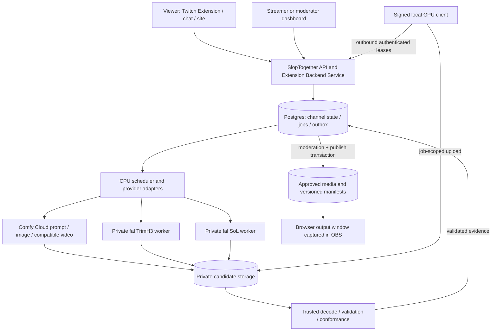

# SlopTogether — implementation plan

Status: product specification and historical implementation notes. The [October 24 implementation audit](../../docs/implementation-audit-2026-10-24.md) and [current completion plan](sloptogether-completion-plan.md) supersede older readiness/deployment assumptions below. Public target: **https://clips.gg/sloptogether**. The application must support continuous streams with no fixed clip-count limit; three/four clips are only smoke-test sizes. The existing Clips.gg database is approved for additive objects in the isolated `sloptogether` schema with a scoped runtime role.

### Earlier deployment snapshot — superseded by the current audit

Current connected-service state was checked rather than inferred from the example configuration:

- The SlopTogether local app is reachable at `http://localhost:3000/sloptogether`; health reports the temporary local Postgres and loopback S3 store configured. OpenAI preflight is now configured locally; Twitch OAuth remains off. `FAL_KEY` is stored only in the ignored, mode-0600 `workers/media-publisher/.env.local` and is absent from the Next.js web process; a regression test confirms public web health does not report worker-provider credentials; local web credentials are in the ignored, mode-0600 `apps/web/.env.local`. The local Postgres data directory is `/tmp/sloptogether-pg`.
- The Vercel account has the existing `clips.gg` host project. Its project listing has no project named SlopTogether; the `/sloptogether` proxy source is not deployed.
- The existing `clips.gg` database is the approved shared project. Migrations now add 44 isolated `sloptogether` tables and a scoped runtime role; actual runtime connection and the configuration inconsistencies in the current audit remain unresolved.
- The SlopTogether workspace has no Git remote configured. The separate Clips.gg checkout is linked to its existing GitHub repository and contains unrelated dirty edits; keep those edits isolated.
- `fal apps list` has no SlopTogether app, `fal secrets list` is empty, and `fal runners list` is empty. The authenticated Fal account check reports ready with no account-level billing restriction. The prior Turbo smoke used the hosted per-request API; no persistent GPU is currently running.
- The shared worker package now includes `sloptogether-fal-worker`, role-scoped Fal secret provisioning, an eight-hour heartbeat/session controller, and builders for isolated generation/upscale Fal contexts. Fal ComfyUI and worker processes run as distinct non-root users, sharing only the input directory. The 51 runtime tests and package wheel build pass. Both remote Fal Docker builds progressed through worker installation and image export. Initial runner validation then failed closed because role-scoped worker secrets are absent; I killed the validation runners and deleted both private apps. Current Fal listings show no SlopTogether apps, secrets, or active GPU runners. Local Docker image validation is unavailable because the Docker daemon is stopped. Production worker keys and a reachable production SlopTogether API/object store are still missing.

Production deployment remains unready: the child application, production runtime connection, Twitch configuration and real storage/worker integration are not deployed. Use the approved shared database only through its app schema/scoped login; preserve all existing Clips.gg public tables. See the current completion plan for the ordered implementation gates.

Companion documents: [confirmed product decisions](../../docs/product-decisions.md), [remaining open questions](../../docs/open-questions.md), [unified worker and streamer control](../../docs/unified-worker-and-streamer-control.md), [moderation and trust](../../docs/moderation-and-trust.md), [acceptance and test plan](sloptogether-test-spec.md), [worker extraction plan](../../docs/worker-extraction-plan.md), [worker import](../../docs/worker-import.md), [clips.gg audit](../../docs/clips-hosting-audit.md), [paid Turbo segments](../../docs/paid-turbo-segments.md), [worker upload protocol](../../docs/worker-upload-protocol.md).

Additional feature contracts: [subscriber interrupts](../../docs/subscriber-interrupts.md) and [cheap H3 story/dialogue planning](../../docs/cheap-h3-story-planning.md).

## 1. Product and scope

SlopTogether is a Twitch-connected collaborative video timeline for each broadcaster. Viewers propose and vote on upcoming prompts and keyframes, channel policy controls review/trust, and workers render the chosen clips. A broadcaster plays the sequence in an ordinary browser window, captured using standard OBS Window Capture. The website provides 16:9 video, play/seek controls and source-position tracking; OBS performs the Twitch broadcast. No OBS plugin, OBS extension, website-to-Twitch restream service or collection of stream keys is in scope.

The application owns identity, choices, timeline consistency, jobs, moderation, publication, and browser playback. The existing inference runtime is one dependency. The same worker program runs for Windows contributors and as Linux/headless workers on fal; it selects generation or upscale and uses identical job/upload/continuity contracts. Ordinary users pair Twitch; owner-managed workers can configure a scoped trusted key. Streamer OAuth or a streamer-control key can override channel editorial decisions. The delivery goal remains the working public application, not a demonstration alone.

| Requirement | Planned behavior |
|---|---|
| R1 — Channel tenancy | Each Twitch broadcaster owns independent settings, roles, branches, jobs, votes, workers, budgets and playhead. Every scoped record/action carries an immutable Twitch broadcaster ID. |
| R2 — Collaborative timeline | Prompt, first-frame and last-frame proposals target future slots; selected end boundary is also the next slot's start boundary. Both approved anchors and continuation-generated endpoints are supported. |
| R3 — Decisions | Manual selection, timed free voting, automatic selection, and optional approved monetization rules can lock a slot. Selection and permission to publish remain separate decisions. |
| R4 — Generation stages | Prompt planning, image generation, base video, optional upscale, trusted validation/conformance, moderation and publication are distinct recoverable stages. |
| R5 — Providers | Comfy Cloud for optional prompt/image and supported video workflows; two independent private fal apps for custom TrimH3 generation and SoL upscale; local volunteers for qualified recipes; paid fal H3 Max Turbo API renders. |
| R6 — Moderation | Fast automated prompt/image preflight; configurable contributor eligibility, reviewer whitelist and uploader auto-approval permissions. Public uploads need approval by default; trusted managed/operator outputs can proceed automatically after cleared inputs and media validation. Bans override these permissions. |
| R7 — Playback | Approximately15-second clips, mandatory 16:9 published video, browser player/clean output view, draggable timeline, history/seek and authoritative browser source playhead; streamer captures that window in standard OBS. |
| R8 — Twitch participation | Chat commands, extension panel/component, EventSub, optional native polls/Channel Points, Bits only for a Twitch-approved product design, attribution and channel configuration. |
| R9 — Unified compute | Shared worker runtime for signed Windows client and Linux/fal deployment; Twitch pairing or owner-issued scoped headless key; user/operator chooses generation/upscale and manual/continuous tasks. Platform/GPU-qualified profiles implement the same contracts. |
| R10 — 4090 | RTX 4090 24GB is a qualification target for each advertised local recipe, not an inferred capability of the current Blackwell deployment. |
| R11 — Isolation | Separate application deployed behind only `/sloptogether` on clips.gg; separate data, secrets and workers; preserve the host app and its current edits. |
| R12 — Integrity | Leases, immutable job inputs, content digests, moderation and trusted publication protect the stream. A signed client does not prove an untrusted user's output was honestly generated. |
| R13 — Paid attempt | A verified payment authorizes one billable generation attempt. Rejection consumes that attempt and reopens the slot for a new contribution/election; another render needs new funding. Reconciliation/transfer retries do not authorize a new render. |
| R14 — Public completeness | Deploy the fully working site at the requested path, with public participation policies, Windows workers, browser output, moderation and qualified provider integrations. Internal milestones and a hackathon demo are progress evidence, not substitutes for the requested release. |
| R15 — Streamer control | Streamer OAuth or explicit streamer-control key overrides channel votes, locks, future prompts/frames/selections, pending work, review decisions and playback. Overrides create audited authoritative revisions/fences; spent payments are not restored and new billable work needs new funding. |
| R16 — Subscriber interrupts | Optional channel setting receives verified Twitch subscription events, creates a funny named approximately15-second story/dialogue clip, and plays it as a ready interstitial before resuming the main story. Gift/resub rules, cooldown, expiry, funding and streamer control are explicit. |
| R17 — Cheap H3 planners | Shared bounded scene schema and source-compatible H3 prompt/dialogue formatter for ordinary stories and alerts. Prefer one small-model call or a safe template; cap tokens/spend and qualify actual speech/audio support. |

## 2. What the repositories establish

The canonical source is `/Users/stale2000/comfy/comfystream` (its README calls the product ComfyStreamer). `/Users/stale2000/comfy/comfystreamerh3` is a separate H3 node snapshot; the canonical repo contains newer Trim-specific code. The canonical repo has local edits; import provenance must capture the actual bytes as well as HEAD. See the import manifest and worker audit for the exact snapshot.

Relevant source surfaces, read as application/worker boundaries:

- `deploy/custom_nodes/fasth3_deploy`: optimized H3 generation, sampling, attention, precision, decode and media output.
- `deploy/custom_nodes/comfystream_sol_refiner_h3`: separate refiner/upscaler runtime.
- `deploy/fal/fasth3-b1` and `deploy/fal/h3-sol-upscaler`: private fal image/configuration references.
- `docs/architecture/worker-artifacts.md`: existing reproducible worker-closure assembly, preferable to copying the full repository.
- `docs/architecture/media-pipeline.md` and `lifecycle-and-recovery.md`: useful admission, durable identity, ambiguous-submit and fencing principles. Their existing desktop coordinator is not SlopTogether's hosted backend.
- `docs/architecture/capabilities.md`: source support is explicitly separate from released installer/GPU qualification. Existing benchmark claims do not qualify our configuration.

Important engineering findings:

1. The current Trim five-step preset is `fp4-mlp-fused-fasth3-trim-5step-vsa20-b1-candidate`. Upstream describes five steps as exploratory because the checkpoint was distilled for eight steps. Preserve both the recipe identity and this qualification gap.
2. The inspected source uses 362 frames at 24fps: **15.083333 seconds**, with length on a `17*n + 5` grid. Fifteen seconds is a product description, not permission to manufacture timestamps or discard endpoints.
3. `first_frame`/`last_frame` are conditioning inputs; they do not prove decoded endpoints equal the input images. Continuity needs an explicit acceptance/conformance contract.
4. Compact source is **448×256 (7:4)**. The current upscaler requires exact source/target aspect ratio; the source profile includes **1162×664**, whereas blindly using the node's 1184×666 default is invalid for 448×256.
5. SoL's upstream default NVFP4/MXFP8 path requires Blackwell; do not route Ada/4090 into those kernels.
6. A SlopTogether local patch now offers automatic Ada FP8 plus sequential CPU offload, gated on 24 GB VRAM, 22 GiB free VRAM and 128 GiB system RAM. The existing Blackwell NVFP4 path remains for sufficiently large/free cards. This candidate has unit-only evidence and still requires Windows 4090 memory/quality/latency qualification.
7. Some files named `benchmark_*` are imported by inference/output paths. Keep the dependency closure; pruning by filename would break the worker.

The host repository is `/Users/stale2000/workspace/clips.gg`. It currently runs Next 16.2.2/React 19, Vercel and Supabase SSR auth, with R2 integration. It has substantial existing uncommitted changes. Its Twitch modules are not a reusable viewer OAuth system. The detailed audit identifies the middleware and rewrite insertion points without changing that checkout.

## 3. Architecture and repository boundaries

Components: a separate Next application and typed API, a supervised CPU coordinator/media validator, the approved private `sloptogether` schema/scoped login in Clips.gg Postgres, private object storage plus approved-media CDN, static Twitch Extension assets, and Python inference/volunteer workers. Runtime readiness is tracked in the current audit and completion plan.



Use Postgres as the first durable queue: transactional job insertion/outbox, `FOR UPDATE SKIP LOCKED` leases, unique constraints, explicit retry times. Do not add a second queue/database until throughput requires it. GPU inference, FFmpeg and long-running scheduling do not run inside Vercel request handlers. Managed realtime carries authorized projections; it is never the state authority. Aggregate vote counts before broadcasting rather than fan out every individual vote.

Proposed first-party layout (future files; only vendor/docs/plans are created now):

```text
apps/web/                  prefixed Next app, dashboard, player, API/EBS
extension/                 isolated Twitch viewer/config frontend, assets and ZIP build
services/coordinator/      scheduling, provider adapters, outbox reconciliation
services/media/            isolated decode, validation, conformance, publication
workers/runtime/           shared roles, engine, leases, upload/story API
workers/client/            Windows launcher/UI and Twitch/key setup
workers/fal/               Linux/fal packaging of the same worker runtime
packages/contracts/        versioned request/job/event schemas
packages/db/               SlopTogether migrations and policies
recipes/                   allowlisted generation/upscale profile descriptors
vendor/comfystream/        pinned worker source + provenance, no app coordinator
docs/                      design, open decisions, deployment/runbooks
```

## 4. Timeline, boundaries and revisions

Use durable slots and immutable revisions, with a graph of alternatives and one selected branch per live session. Do not represent the product as a mutable array of video URLs.

| Entity | Essential identity/data |
|---|---|
| `channel` | Twitch broadcaster ID, independent contributor/reviewer/upload-auto-approval policies, trusted execution bindings, settings revision, budget and feature flags |
| `live_session` | channel, selected branch, controller epoch, output format, published manifest revision |
| `branch` | channel/session, parent/fork point, selected revision, archive state |
| `boundary_revision` | immutable canonical keyframe asset + digest, source/proposer, moderation, normalization transform |
| `segment` / `segment_revision` | branch/slot, immutable prompt/start boundary, nullable immutable requested end boundary, provider recipe, source/published duration, selection state |
| `endpoint_resolution` | append-only record linking segment input digest, accepted source artifact/digest, resolved end boundary and moderation evidence; one current accepted resolution, dependency links to its consumers |
| `proposal` / `election` / `ballot` | target slot/revision, prompt/image candidate, author, eligibility snapshot, deadline/rule, one active ballot per identified user/election |
| `job` / `job_attempt` / `lease` | stage, input digest, recipe/model/source hashes, execution binding, fencing token, attempts, deadlines and cost reservation |
| `artifact` / `validation` / `moderation` | input/output hashes, authenticated producer/execution binding, private object, preflight evidence, policy/model version, exact review target, human reviewer or explicit system approval path |
| `publication` | immutable approved artifact mapping, timeline PTS coverage, manifest revision and replacement history |
| `playback_session` / `playback_event` | source controller, epoch, clip/offset, monotonic sequence, server timestamp, observed health |
| `participant` / `channel_membership` / `ban` | Twitch identity, roles, channel/global restrictions and worker status |
| `engagement_transaction` | verified provider transaction identity, product/rule/target snapshot, single-use billable-attempt authorization/consumption, terminal rejection/failure outcome; separate from compute costs |
| `upload_reservation` | user/device, channel, job/attempt/fence, temporary object, byte/type limits, expiry and server-owned snapshot identity |
| `event_receipt` / `interrupt` | verified/deduplicated subscription event, channel policy snapshot, gift context, one planned alert/render identity, owner funding and ready/expiry/cancel state |
| `program_item` | ordered story span or interrupt artifact, source-span mapping, output PTS, resume anchor/controller epoch; source-story slots remain separate |

### Boundary rules

- A playable clip `i` resolves to boundary `B(i+1)` and clip `i+1` starts at that **same boundary revision**. Keep one canonical reference; do not duplicate two independently editable start/end images. Before continuation output is accepted, its end is unresolved rather than a placeholder mutable input.
- Each generation method receives derived, size-correct input images. Store the master asset, transformation recipe and derived digest. Never quietly stretch images or replace an adjacent shared boundary with another crop.
- **Planned-anchor mode:** `start_boundary_revision_id` and `requested_end_boundary_revision_id` are approved and fixed before rendering. After conformance, `resolved_end_boundary_revision_id` must match the requested end boundary. Unrelated future slots can render in parallel, including a slot roughly ten minutes ahead.
- **Continuation mode:** the start is fixed and `requested_end_boundary_revision_id` is null in the immutable job inputs. A trusted stage extracts the accepted source render's actual final frame and proposes a new boundary. Validation/moderation creates an `endpoint_resolution` containing `resolved_end_boundary_revision_id`, its source artifact and the original input digest; it does not fill in or change the requested input. The next job waits for acceptance and records both that resolution ID and its resolved boundary as dependencies. This mode is naturally sequential at the moving tail.
- In planned-anchor mode, verify model endpoint adherence, then a trusted conformer can enforce displayed endpoint frames using a documented clamp/blend policy. Reject visibly unacceptable transitions. Identical canonical boundary IDs are an input guarantee; lossy-encoded output equality and visual smoothness need measured tolerances.
- Once a boundary is locked by an adjacent selected segment, changing it requires an atomic edit of every mutable dependent segment or a new branch. A donation, vote or moderator action cannot silently mutate the neighbor's frozen input.
- Changes to requested inputs produce new revisions and invalidate dependent pending results. Accepting an output-derived resolution is an output transition and leaves the producing job's input digest/revision intact. Superseding an accepted continuation source artifact retires its current resolution and fences its affected downstream jobs, derived endpoint resolutions and approvals atomically through their dependency links; already-published history stays immutable and subsequent changes use a new branch. A late worker result remains attributable but cannot attach to the replacement revision.

An optional upscale must conform to the accepted canonical boundaries. It cannot replace the continuation boundary with its own different final frame or silently invalidate the next clip. Competing endpoint acceptance/replacement uses compare-and-swap on the selected source artifact/resolution; only one current accepted resolution can feed descendants.

### Fork entry and rejoin

A new branch must enter at an unchanged, accepted shared boundary outside the protected playback buffer. Copy the unchanged prefix, then regenerate the affected transition(s) from that boundary to a proposed new start image. Do not fork only at the edited slot and keep its old predecessor if their anchors differ. If the old predecessor is locked on the original branch, it remains untouched there; the fork has its own replacement predecessor, revision and cost reservation.

To reuse an existing suffix, the fork must resolve to that suffix's exact start-boundary revision and pass the same visible-join checks. Otherwise generate an outgoing bridge or continue the new branch without reusing that suffix. If no suitable unplayed boundary exists before the edit, move the proposed edit later or explicitly perform a discontinuous seek/cut with a new playback event and manifest discontinuity. Never label that operation a seamless branch switch. The original branch, published history and paid target/fulfillment records are not implicitly moved to the fork.

### Duration decision

User decision: clips are **about 15 seconds**, not an exact15.000-second slot grid. Preserve valid native durations (Trim's362/24 seconds is acceptable); configure managed15-second requests and use measured output PTS in scheduling. Do not truncate endpoint frames merely to reach15.000 seconds, and do not schedule by `slot_index * 15`.

### Required16:9 publication

All public browser output and final playback media are **16:9**. Initial publication target is1280×720; other advertised delivery sizes must retain that ratio. Native generation/upscale intermediates may remain448×256/1162×664 to respect the inspected7:4 node contract. The trusted conformer fits/pads those into 16:9 without stretching; show the same transformation in frame previews and apply it consistently to adjacent canonical boundaries. A native16:9 provider path goes through the same publication-size/timing validation. Internal model geometry does not change the public output requirement.

### Independent state dimensions

Selection: `OPEN -> VOTING -> SELECTED -> LOCKED`, with `CANCELLED/SUPERSEDED` alternatives.

Execution per stage: `BLOCKED -> READY -> LEASED -> RUNNING -> UPLOADED -> VALIDATING -> SUCCEEDED`, with `EXPIRED/FAILED/CANCELLED/UNCERTAIN` as explicit outcomes.

Review: `PENDING -> APPROVED / REJECTED / REVOKED` on each exact asset/revision.

Publication: `UNPUBLISHED -> COMMITTED -> RETIRED`.

An approved prompt is not an artifact approval. A generated asset becomes playable only after media validation and the channel's human or explicitly trusted system-approval path; both paths are auditable. A selected slot is not guaranteed to meet the playback deadline.

## 5. Decisions, locks and a ten-minute-ahead example

Each channel configures allowed selection modes, voting window, tie-breaker, generation lookahead, minimum moderation time, maximum cost, participation permissions and whether manual picks can override an uncommitted result.

Recommended initial rules:

1. Channel settings choose any authenticated non-banned contributor, broadcaster/moderators only, or an explicit contributor allowlist. Every executable contribution is bound to its connected Twitch identity. Effective prompt and actual input images pass fast automated preflight before paid dispatch or public voting; contributions remain attributable and review/removal controls stay available.
2. The Twitch Extension and chat both support voting, alongside the website. They submit to the same channel/election/choice service with one active free ballot per verified Twitch identity per election; changing it through another surface updates that ballot rather than adding another vote. Changes remain allowed until the server deadline.
3. The server closes the election against its own time and freezes its rule version, eligible choices and outcome. Resolve ties deterministically using a rule disclosed before voting begins.
4. A selected prompt/frame pair can lock only if adjacent boundary constraints are satisfiable, budget is reserved, and the slot is outside the protected playback buffer. A planned-anchor lock freezes both requested boundaries; a continuation lock freezes its start and null-requested-end policy without waiting for the output it will generate. A successor can collect proposals early but cannot dispatch until its upstream resolution is accepted. Use compare-and-swap revisions inside one transaction.
5. For the owner's initial continuous stream, a test-story adapter feeds future scenes using the same shared worker/API contract. The two Linux/fal instances run that worker program with configured trusted keys, one generating and one upscaling. Trusted key scopes permit future-content writes/system approval; an explicitly granted streamer-control scope can also replace votes/locks. A universal built-in empty-queue story planner for all channels is not required; publication remains server-owned.
6. A paid threshold, if enabled for an approved payment design, affects **selection priority or a specified action**, not permission to bypass moderation, overwrite a locked neighbor, run arbitrary code, or promise exact playback time. The target and policy are frozen when the intent is created.

Example: a viewer picks a slot around +10:00, proposes a prompt/keyframe and allowed render quality. A conflicting locked neighbor requires a valid mutable-interval edit or fork/bridge as specified above. After clean preflight and selection, the server locks inputs and dispatches one funded attempt. Output is validated, optionally upscaled by another chosen worker, then receives human or explicitly trusted system approval. If rejected, fence that candidate/descendants, consume its already-used paid attempt, and reopen the slot/election without changing locked neighbors. A later paid render needs a new transaction. Only admissible publication reaches the 16:9 browser source. ETA updates with seeks/durations and is not an airing guarantee.

Worker leases and editorial locks are different: an unpaid donor job can be reassigned under its lease policy; this never grants another billable render against a consumed payment. Rejection retires the selected candidate, preserves required neighbor anchors and creates an OPEN slot/new election revision for another contributor or vote. Fence old leases/completions so they cannot refill the reopened slot. The rejected artifact and payment remain terminal/auditable; there is no reusable paid regeneration credit.

### Streamer authority over future content

An authenticated broadcaster or explicitly issued streamer-control key can force channel choices above normal voter/contributor locks: select/edit prompts and frames, lock/unlock or supersede a future slot, replace selected work, approve/reject/hold, stop generation and seek/switch playback. The backend executes this as a named override transaction, records old/new choices and actor/key, advances the relevant revisions/epochs, fences stale work and re-evaluates affected boundaries. If a seamless join is impossible, the controller may intentionally choose a recorded cut/seek. Do not require the old vote winner or contributor to consent to a streamer override.

Streamer review may explicitly resolve a held input under channel policy; keep the original classifier result and a separate authorized review decision. Ordinary worker trust does not itself clear a hold. Overrides still use validated identities/media and accurate accounting: already-spent viewer payments stay spent, replacement generation uses a fresh owner/channel reservation, and published/broadcast history remains an immutable record. Channel control does not confer authority over another channel or the underlying ClipsGG application.

## 6. Twitch features and permissions

The website and Twitch Extension call the **same channel-scoped API/EBS**. The extension is a static client served through Twitch's extension distribution; it is not a place to store secrets or run the backend.

The Twitch voting Extension is a required client, separate from the OBS plugin/extension that is unnecessary for browser capture. Show upcoming eligible prompt/frame choices in the Extension; chat commands can cast/change the same free ballot. Backend election state and streamer overrides are reflected across both. Do not combine an optional native Twitch poll's anonymous aggregate with identified Extension/chat ballots as if they were independently deduplicated individual votes; select an explicit counting mode for that optional poll.

| Surface | Integration |
|---|---|
| Extension viewer panel/component | Upcoming slot choices, moderated image previews, voting, generation status, current clip attribution, link to permitted full timeline views. Keep a panel/mobile layout first; add overlay after utility is proven. |
| Extension config/dashboard | Broadcaster installs/selects channel, participation settings, selection modes, moderation rules, provider budget and Bits availability. Sensitive operations still require server authorization. |
| Chat | `!slop propose`, `!slop vote <choice>`, `!slop next`, `!slop status`, `!slop help`; moderator commands can approve/hold/skip through the same audited service. Parse bounded input; respect bot quotas and suppress repetitive announcements. |
| EventSub | Chat, native poll results, Channel Points redemptions, stream online/offline, moderator changes and optional eligible cheer/sub events. Bind conditions to installed channel IDs and reconcile revoked subscriptions. |
| Subscriber shout-outs | Optional new-subscription, shared resub-message and aggregate-gift modes create cheap funny H3 scenes with short spoken thanks. Ready media interrupts the browser program at an eligible boundary, then resumes without taking a paid story slot. |
| Native Polls | Optional Twitch-hosted vote for 2–5 approved choices; one poll at a time and eligible channels only. Do not add native poll totals to duplicate site ballots without an explicit separate counting mode. |
| Channel Points | Approved proposal/choice or configured action reward; fulfill/cancel reward through verified EventSub/API processing. No conversion into cash/GPU balances. |
| Bits | Separate approved catalog/rule integration with verified receipts, idempotent fulfillment and transaction reconciliation. Check the extension's Bits-enabled capability. |
| Attribution | Link submitted content to the verified Twitch username; show author/worker credit subject to privacy choices. |
| Stream metadata | Optional chat announcements and Twitch stream markers at selected moments; Twitch VOD markers are not our source-playhead authority. |

Policy constraints materially affect the requested product. Twitch allows Bits voting but restricts user/broadcaster-defined exchanges and selecting a particular audiovisual work, and prohibits calling Bits a donation. UGC requires linked Twitch identity, attribution and broadcaster review/removal controls. Keep free-form prompt/image contributions free; keep any paid mechanism disabled until its precise catalog and voting behavior pass Twitch review. A moderator-approved custom prompt is not automatically an allowed Bits product. Free website/chat participation remains usable without Extension approval or channel monetization eligibility. Source: [Twitch Extension policies](https://dev.twitch.tv/docs/extensions/guidelines-and-policies/).

Use optional native polls/Channel Points only when channel capabilities and granted scopes permit them. Poll details: [Twitch Polls](https://dev.twitch.tv/docs/api/polls). Extension frontend identity and latency come from a JWT-verified EBS integration; see [Extension reference](https://dev.twitch.tv/docs/extensions/reference/). Use current EventSub for chat, not retired general Twitch PubSub. Extension-specific PubSub messaging remains a distinct supported extension facility.

Scope plan: basic Twitch identity for viewers; progressive broadcaster consent for `moderation:read` (moderator membership), `channel:bot` as required by selected cloud chat mode, `channel:manage:polls`, `channel:manage:redemptions`, and optional marker/stream capabilities only when enabled. A separate bot account uses `user:bot`, `user:read:chat`, `user:write:chat` as appropriate. Confirm exact token/transport scope combinations against current endpoint docs during implementation; do not ask every viewer for broadcaster/bot permissions. [Scopes](https://dev.twitch.tv/docs/authentication/scopes/), [chat authentication](https://dev.twitch.tv/docs/chat/authenticating/).

Subscriber interrupts additionally request broadcaster `channel:read:subscriptions` only when enabled.

### Optional subscriber interruption flow

Use Twitch **EventSub**. `channel.subscribe` reports new subscribers, `channel.subscription.message` shared resub messages, and `channel.subscription.gift` batch gifts. Verify transport/HMAC, deduplicate durable receipts and check channel opt-in before planning/spending. Aggregate-gift mode ignores recipient `is_gift` subscribe events, preventing duplicate renders; anonymous gifts retain an anonymous label. Names/messages are bounded data, not instructions. [Official subscription types](https://dev.twitch.tv/docs/eventsub/eventsub-subscription-types/).

Create one budgeted interrupt plan/attempt from the event, using the small H3 planner. Prioritize eligible alerts without silently killing already-billed work; cap backlog, cooldown, event age and costs. Twitch subscriptions do not create Bits-generation entitlements or an automatic app-owner payment share. Explicit owner/channel funding covers alerts; failure/expiry uses cheap acknowledgment/skip instead of unlimited retries. Streamer control can cancel/defer/force an interrupt and fence stale event work.

A ready clip becomes a separate program interstitial, not a main-story/paid-slot replacement. At an eligible boundary beyond the committed output prefix, save the main-story resume anchor/controller epoch, play the alert with a deliberate discontinuity, then resume only the currently authorized story position. A later streamer seek/override invalidates stale saved resume state.

Keep a deep **ready-content** buffer separate from a short **program commit/prefetch** window: minutes of prepared story must not force minutes of decoded playback before insertion. Change program ordering only beyond announced/appended immutable media; never rewrite an HLS prefix already playing. Generation makes this ready-later, not an instant-video promise. Detailed contracts, gift modes and limits are in [subscriber-interrupts.md](../../docs/subscriber-interrupts.md).

## 7. Authentication, authorization and security

### Website and channel authority

- Use server-side Twitch authorization-code flow, exact allowlisted callback `https://clips.gg/sloptogether/auth/callback`, one-use CSRF state, server-held client secret and encrypted OAuth refresh tokens. Do not assume unsupported OAuth variants without checking Twitch's implementation.
- Store SlopTogether's opaque session in its own Secure/HttpOnly cookie scoped to `/sloptogether`; use a unique name, SameSite policy and session rotation. Validate return paths against the application prefix. Do not reuse ClipsGG cookies or grant ClipsGG admins implicit SlopTogether broadcaster authority.
- Twitch broadcaster ID establishes channel ownership. Twitch moderator membership is fetched/reconciled server-side with the appropriate channel grant and optional local delegation policy; remove privileges on revocation. Check roles again on every privileged mutation, with a bounded refresh TTL and fail-closed handling for stale privileged authority.
- `/validate` token checks run when sessions start and hourly while maintained, with session invalidation on revocation; handle 401 immediately. [Twitch token validation](https://dev.twitch.tv/docs/authentication/validate-tokens/).
- All object lookups are tenant-qualified. Database constraints/RLS reinforce tenant boundaries, including realtime subscriptions. Public projections contain only approved content; secret/provider tables have no browser access.
- Session cookies need CSRF/Origin checks for writes. Rate limits cover user, channel and device; a global compute cap protects against many-account abuse. Implement the requested public-nonbanned/role/allowlist contribution modes, reviewer permissions and separate upload-auto-approval grants per channel. Channel/platform bans override every allowlist; an ordinary contributor/reviewer grant does not imply upload auto-approval or trusted execution.

### Extension identity

Verify helper JWT signature with the configured decoded extension secret, allowed algorithm, expiry, channel ID and claimed role. Browser-reported role/username is never sufficient. Require linked identity for submissions, publishing and persistent user-linked actions. Bind EBS authorization to the JWT's channel, not a caller-supplied broadcaster ID. Extension requests use verified bearer-style JWT auth and explicit CORS; they do not depend on third-party website cookies.

Validate Bits receipts server-side, bind transaction/product/channel/user to a pre-created action intent and enforce uniqueness. Persist uncertain/incomplete fulfillment and reconcile Twitch transaction history; a frontend completion callback alone cannot award votes or schedule compute. Do not claim atomicity across Twitch's charge and our database: retain an unfulfilled entitlement/repair path if a verified transaction arrives after target closure.

Current Twitch docs expose `extension.bits_transaction.create`; use that verified EventSub event plus transaction-history reconciliation for robust backend fulfillment. Native Twitch Polls do not support Bits voting; paid Extension ballots/actions use our own verified EBS ledger. The proposed owner revenue, regular-rate provider costs and product examples are in [paid-turbo-segments.md](../../docs/paid-turbo-segments.md).

### Events and provider callbacks

EventSub uses HMAC-SHA256 over ID + timestamp + **raw** body, constant-time comparison, replay-age rejection and deduplication. Persist/queue verified events before acknowledging; do not run generation in the callback. [Webhook handling](https://dev.twitch.tv/docs/eventsub/handling-webhook-events/).

Use provider-specific verified callbacks where available, otherwise reconcile job state through authenticated provider reads. An arbitrary callback claiming success never admits media. Normalize callback/output URLs against explicit provider/storage allowlists; block private-network URL fetching, redirects outside allowed hosts, and worker-supplied arbitrary output paths.

### Volunteer client and media boundaries

The executable opens a browser to our Twitch login/pairing page. A short-lived one-use pairing flow issues a per-device credential scoped to approved channels and job types; do not bundle a Twitch client secret, fal key, Comfy key or object-storage credential. Use OS credential storage, revocable tokens and outbound HTTPS only. Bind authorized job leases to the device key and current user ban state.

That pairing is the ordinary user path. The same program also accepts an owner-issued worker/streamer key for Linux/fal headless operation. Verify the key server-side and bind it to its issuing Twitch/channel identity, permitted roles and scope; do not require a cloud runner to perform interactive Twitch login at each startup. Keep the secret in OS storage or a deployment secret/file, store only its verifier/metadata on the server, and support rotation/revocation. Distinguish worker execution, trusted future-content authoring/approval, and full streamer-control scopes; an explicit full-control grant can be configured on the owner's workers. See the unified-worker credential design.

Only allow signed, pinned recipe IDs with bounded typed inputs. Never execute workflow graphs, node Python, shell commands, pip packages or model URLs supplied by viewers/jobs. Download model files from allowlisted manifests with digests and licenses; prefer safe tensor serialization. Run the local Comfy process on loopback with a per-launch control token or protected local adapter, not an open LAN port. A malicious website must not be able to command a privileged localhost worker through CORS/DNS rebinding.

Uploads land in private quarantine through short-lived job/attempt-scoped tickets with byte/type limits. The backend computes its own digest, then isolated CPU decoding checks actual media, frame count, timestamps, dimensions, codec and safety before creating safe publication media. Strip metadata and do not serve HTML/SVG/executables or raw untrusted media from the main clips.gg origin. Media processing gets CPU/memory/time limits and no broad network/storage credentials.

The complete Twitch-to-device-to-Cloudflare sequence, REST endpoints, token lifetimes, upload URL response and overwrite/TOCTOU protections are specified in [worker-upload-protocol.md](../../docs/worker-upload-protocol.md). Public donor uploads need enforced byte quotas, not a presumed size limit attached to a bare presigned R2 URL.

## 8. Job contracts, scheduling and recovery

Use a versioned stage request, stored before dispatch. Example shape:

```json
{
  "schema": "sloptogether.job.v1",
  "job_id": "uuid",
  "channel_id": "twitch-broadcaster-id",
  "segment_revision_id": "uuid",
  "stage": "video.base",
  "recipe_id": "trimh3-5step-qualified-profile",
  "recipe_sha256": "...",
  "input_digest": "...",
  "prompt_revision_id": "uuid",
  "start_boundary_revision_id": "uuid",
  "requested_end_boundary_revision_id": null,
  "assets": [{"asset_id": "uuid", "sha256": "...", "role": "start_frame"}],
  "seed": 12345,
  "source_format": {"width": 448, "height": 256, "fps_num": 24, "fps_den": 1, "frames": 362},
  "lease": {"attempt_id": "uuid", "fence": 4, "expires_at": "server-time", "attempt_deadline_at": "server-time"},
  "result_deadline_at": "server-time"
}
```

The null requested end in this example represents continuation mode. Its eventual `endpoint_resolution` is a separate output record with `source_artifact_id`, server-computed `source_sha256`, original `input_digest` and `resolved_end_boundary_revision_id`; none of those discovered values is patched into the frozen request. Planned-anchor requests instead contain the fixed end-boundary ID. Record any upstream resolution ID consumed by this job as an immutable dependency.

Asset download URLs are derived short-lived capabilities delivered only after authorization; persist asset IDs/digests, not signed URLs. Device cannot select another channel or amend inputs while claiming an existing job. The contract includes qualified hardware/runtime/model identifiers, precision, expected output schema, resource caps and upload-ticket references, omitted from the short example for readability. Attempt-deadline authority remains server-owned even if the worker's clock differs.

Rules for the scheduler:

1. Resolve dependencies into READY jobs only when their exact input revisions/assets and any upstream endpoint resolution are admissible. Generation consumes prompt/anchors; continuation successors also consume an accepted resolution ID. Upscale consumes the accepted **base artifact digest** and cannot race a replacement source or redefine its canonical endpoint.
2. Worker chooses a channel and allowed stage(s). Auto mode leases eligible tasks continuously; manual mode requests a named eligible job through the same compare-and-swap lease operation.
3. Prefer committed branch and imminent playback deadlines, then reserved eligible jobs, then speculative alternatives. Respect fairness/channel quotas and contributor permissions; a viewer cannot make arbitrary expensive jobs high priority.
4. Maintain class-specific p50/p95 time estimates including cold start, upload, trusted validation and review backlog. Hide unavailable recipes and distinguish estimated readiness from a guarantee.
5. A volunteer lease carries renewable expiry, immutable absolute `attempt_deadline_at`, attempt identity and monotonic fence. Heartbeats may extend expiry only up to that absolute deadline, never the deadline itself. Enforce the lifetime, claim caps, upload grace and retry/cooldown policy below; late completions fail currentness checks. Cancellation stops publication authority immediately even when remote GPU cancellation is unavailable. Managed-provider ambiguity still follows rule6; expiring a local lease never proves another billable provider submit is safe.
6. Store the local submit intent, attempt identity and client idempotency key before dispatch. Persist the remote provider request ID when it becomes known (often only in the acknowledgment). If acknowledgment is lost, mark UNCERTAIN: reconcile by a supported client key or known remote ID; if neither lookup is supported and the remote ID is unknown, HOLD the attempt/spend reservation for operator reconciliation instead of claiming recovery or sending another job. Prefer provider idempotency when supported; do not invent exactly-once remote execution.
7. Logical completion is idempotent: one accepted output per current stage input revision. A transaction's billable-attempt allowance is consumed atomically for at most one generation dispatch; duplicate results, reject/reopen, new revision, or retry buttons cannot create another funded render. Transport retry/retrieval of that same request/output is allowed; a genuinely new generation needs fresh funding. Unknown provider acceptance remains held, never reset to an unused allowance.
8. Reserve budget transactionally before dispatch, reconcile actual provider usage, and retain uncertain spend reservations. Limit per-job cost, per-channel daily spend, global spend, concurrency, regeneration attempts and maximum future horizon.
9. Prioritize a safe playable buffer over speculative votes and qualify continuous fresh output against the capacity gate below. When capacity or moderation is insufficient, use approved fallback loops/slates, hold, or choose an already-approved branch. Never auto-air pending content because a clock ran out.

### Volunteer lease bounds

Each enabled stage/hardware recipe must define server-owned maximum total attempt time, including model startup, input download, generation and upload. A recipe without a qualified bound cannot accept public volunteer claims. On claim, freeze `attempt_deadline_at = min(claimed_at + profile.max_attempt_seconds, job.result_deadline_at)`; reject claims whose measured work/transfer estimate cannot fit the remaining window. The job's result deadline reserves subsequent validation/moderation time before playback. Client clock, progress percentage and heartbeats cannot increase either deadline.

Initial renewable-lease defaults: heartbeat every 30 seconds; expiry 90 seconds after the latest accepted heartbeat, capped at the absolute attempt deadline. An upload may receive at most 120 seconds of grace within the same absolute deadline, never beyond it. The profile's total budget includes that grace. When issuing or refreshing an upload ticket, cap its expiry at the remaining lease/phase deadline and recheck authority at completion.

Start with at most **two active donor attempts per Twitch account globally**, at most two for that account in one channel, and one per registered worker slot. Account limits aggregate across devices and count rendering/uploading attempts; a second registered GPU can perform the other role within those two claims. Channel-wide admission caps still apply. Higher limits require an explicit trusted-operator policy rather than another self-reported device identity.

At renewable expiry or the absolute deadline, atomically fence/revoke the attempt and release its donor claim slot; a separate eligible worker can claim a new attempt for the same current job. Preserve already accepted server snapshots, reject further uploads/completions from the old fence, and clean private abandoned objects. The scheduler must run this expiry check independently of incoming heartbeats, so a continuously connected worker cannot block reclamation. Three expired/nonproductive donor attempts in a rolling 24 hours trigger an initial 15-minute claim cooldown and a trust-review flag; a channel can revoke sooner for abuse. These are configurable starting limits, not measured runtime claims.

### Sustained fresh-output qualification

Before labeling a configuration continuous fresh generation, run at least 60 minutes at 1x forward playback under its declared worker counts, hardware, model/quality, safety and human review policy. Start with 180 seconds of contiguous approved playable material and keep sufficient eligible future work available within the configured horizon. The scheduler's approved-buffer high-water mark must permit at least 540 seconds at the hour's end (`180 + 3960 - 3600`), plus one normal admitted batch: use 600 seconds for initial one/two-clip batches, or raise the measured horizon/limit if larger batches require it. A cap at the starting 180 seconds would throttle healthy production and invalidate this capacity probe. Apart from that prebuffer, do not prime the window with pre-rendered/preprocessed video: qualifying media's required video stages must execute during observation. Proposed pass criteria are:

- Newly approved **contiguous selected-branch** media produced during the measured hour totals at least 1.10 seconds per elapsed playback-second (10% headroom), and at least 1.00x in each of its four consecutive 15-minute intervals. Exclude prebuffered content, repeat plays, fallback loops, rejected work, speculative branches and second counting of an upscale variant. Longer qualification runs use the same rate and buffer criteria over their full duration and consecutive 15-minute intervals, with sufficient horizon for the additional headroom.
- The contiguous approved buffer never falls below 120 seconds, ends no smaller than its starting depth, and playback never waits for a missing/unapproved next slot. Report buffer trace and review coverage, not only total completed media somewhere on the timeline.
- Include prompt/keyframe preflight, generation, optional upscale, transfer, trusted validation, rejected/newly funded work and the configured approval path in measured capacity. Test both continuous trusted-managed system approval and public-upload human-review queues under their actual policy; do not impose a human-per-clip pause on trusted mode. A run with different trust/review/fallback behavior qualifies that specific mode only.

For planning, measure each stage's effective accepted media-seconds per wall-second. Overall capacity is bounded by the slowest required stage; use those measurements to size generation/upscale/validation pools and review coverage. One generator plus one upscaler is an initial topology, not proof either can meet the target. If the gate fails, report **buffered playback with safe fallback**, add budgeted workers, choose a qualified cheaper/faster profile or change review staffing, then rerun the gate before making a sustained-fresh-output claim. Mandatory moderation is never relaxed to pass throughput.

Typical work stages: `prompt.plan`, `image.boundary`, `video.base`, `video.upscale`, `media.validate`, `media.conform`, `publication.prepare`. Volunteer executables initially expose only base/upscale stages; prompt/image generation can use Comfy Cloud without loading more models on a donor GPU. The server always owns validation and publication.

For the initial test stream, `prompt.plan` comes from the owner's test-story adapter in or alongside the shared worker program rather than a required hosted autonomous planner. A channel producer lease/epoch elects at most one story writer so the two workers do not invent duplicate future slots; streamer override can supersede that writer. Do not import the old desktop coordinator or OBS integration into the app.

Provider capability records explicitly describe first/last-frame support, dimensions/frame-grid/duration ranges, audio, precision, cancellation/inspection/idempotency and cost-estimate freshness. A provider missing required endpoint control is not an automatic substitute for a locked two-anchor job.

## 9. Comfy Cloud and fal

For new Comfy Cloud integration use the current versioned **Comfy API v2** or its official SDK, not a newly written v1-only client. Keep backend-held credentials, known workflow versions, bounded parameters, upload/job/status/output identities and restart recovery. Prompt/image nodes are optional and need live catalog/schema validation. Do not assume our custom Trim node is installed in shared Comfy Cloud; use the pinned private worker environment for that path. [Comfy API v2](https://docs.comfy.org/api-reference/v2/overview).

Current external check: the installed Comfy CLI is signed in with a stored API key, but no local ComfyUI server is running. The SlopTogether app has a server-side Comfy Cloud API v2 adapter and durable job state. Its current GPT Image 1.5 workflow validates against Cloud and one low-quality CLI smoke generated a 448×256 frame; that does not qualify the production app endpoint. Production gates and the `stale2000` allowlist are configured, but the production `SLOPTOGETHER_COMFY_API_KEY` is absent, so the live page hides the button. Comfy actions remain manual and require a signed-in broadcaster or verified Twitch moderator plus confirmation; do not add automatic generation triggers. Comfy Cloud is paid; the shared account permits one active/uncertain job at a time and uses idempotency keys that reject duplicates rather than replaying results.

Copy provider outputs into SlopTogether-owned storage after validation. Provider output links may be authenticated or expire; persisting a returned URL is not durable CDN publication. A later API adapter can support a compatible dedicated Comfy deployment through the same job interface.

Use **two private fal apps, one GPU each**, as the initial managed compute pool: generator and upscaler. This matches their independent queues, model residency, failure recovery and scaling. `num_gpus=2` in one app is not equivalent to two task-specialized workers. Provider-hosted fal compute is rented capacity; donor-owned PCs run our local client, not a fal serverless deployment.

The imported Docker/config files are references, not SlopTogether deployments. Create SlopTogether-owned app names, staged build context, secrets, model manifests, health/warmup endpoints, status/output contracts and maximum concurrency. Do not change or start the upstream app IDs. Target the exact architecture-qualified machine type; validate current capacity/prices before deployment. Limit duplicate/cold-start charges and distinguish "no new jobs" from "GPU scaled to zero" in control state.

Official references: [fal custom runtime](https://fal.ai/docs/documentation/development/container-setup), [machine types / GPU count](https://fal.ai/docs/documentation/deployment/machine-types), [deployment and revisions](https://fal.ai/docs/documentation/deployment/deploy-to-production).

### Same worker program on Windows and Linux/fal

Package one worker engine/CLI with platform-specific launchers and dependencies: Windows executable/UI for contributors, Linux headless build/container for fal. This is shared source, nodes, recipe identities, role selection, queue/lease and upload protocol—not a claim that a Windows executable binary runs on Linux. The owner's two fal containers launch this same program with generation/upscale roles and configured channel-scoped trusted keys.

Flow: a key-authorized test-story writer registers future prompt/frame revisions -> site input clearance -> generation worker claims one authorized job -> local pinned nodes produce/upload base media -> upscale worker claims that accepted source -> same upload/admission path -> trusted policy approval ->16:9 browser source. The writer has a producer lease/epoch; it can be an adapter/mode in the shared program, with only one active writer per channel. Streamer-control grants allow intentional authoritative replacement of future decisions rather than creating a separate privileged implementation.

Use `pull_worker` execution ownership for jobs consumed by these long-running workers. The backend creates/leases them once and must not also submit an inference call for the same job through a provider dispatcher. Keep `provider_queue` for hosted marketplace requests such as paid H3 Max Turbo; their uncertain-submit rules remain intact. A local Comfy child is an implementation detail of the shared worker, not an exposed arbitrary-workflow endpoint.

The owner starts/configures the two fal deployments and their warm/persistent runner behavior deliberately. Polling in a background process does not itself establish fal runner lifetime, scale-to-zero behavior or billing state; qualify those deployment settings and cap spend. Secrets come from deployment secret storage, never image layers or public clients. Record worker/execution identities and owner-funded reservations; viewer-paid authorizations remain single-use. If either process stops, the public site/other channels continue and existing content remains playable; the source browser uses configured fallback/hold when its buffer empties.

### Paid marketplace render lane

Add exact endpoint `minimax/h3-max-turbo/image-to-video` as an optional paid model/quality upgrade, using our backend-held fal key. Its current schema exposes both first/end image URLs and up to 15 requested seconds, with possible output overrun; normalize the returned clip before admission. This is separate from hosting our own nodes on fal. Use explicit resolution and prompt-expansion settings rather than API defaults. Details, source snapshots, pricing formulas and verified Bits fulfillment are in [paid-turbo-segments.md](../../docs/paid-turbo-segments.md).

The developer's ordinary Bits share is fixed by Twitch; it must cover the provider bill and operating costs. Reprice against regular configuration-specific rates when promotions end, and pause products when margins or compute reserves are inadequate. The owner earns the developer share through a monetized Extension, not by listening to ordinary chat Cheers. Exact paid slot/custom content behavior still needs the policy review described above.

### Low-cost H3 story and shout-out planning

Use one bounded scene schema/compiler for the owner test-story adapter and subscriber alerts. Reuse/extract existing pure `flow_planner.attach_dialogue`: `[Shot 1]`, `integrated_multimodal_description`, speaker IDs such as`S1`, `<d>[English] ...</d>`, `overall_soundscape`, `non_diegetic_music`, and at most30 plain spoken words. The model returns validated plain visual/dialogue fields; the adapter supplies markup and server-owned identities. Avoid multi-agent screenplay/reviewer passes for each short alert.

Use one small-model planning call or a screened template with strict tokens/deadline/budget and deterministic fallback. The inspected Comfy dialogue planner already defaults to `gpt-6-luna`; qualify that or another cost-effective adapter instead of requiring a large model. [Source contract and current cost example](../../docs/cheap-h3-story-planning.md). Free moderation is distinct from paid text generation, and Comfy/provider overhead is not included in a direct-model estimate.

Subscriber shout-outs explicitly require spoken dialogue. Qualify an audio-capable H3 recipe; preserve/mux source audio through upscale and16:9 conformance; validate actual intelligibility/timing in browser/OBS capture. A cartoon character can acknowledge a sanitized subscriber label without copying their real face/voice. Reuse safe styles/start images when useful and screen every effective prompt/frame. Arbitrary music/audio uploads remain a separate policy choice.

## 10. Volunteer executable and RTX 4090 qualification

The desktop UX is: install signed executable -> Twitch sign-in through browser -> choose channel(s) -> hardware check -> choose generation/upscale/both -> approve cache footprint and resource limits -> idle/manual/continuous work. Explain disk/model downloads, GPU power, upload bandwidth and what content a worker will receive before enabling a channel. Viewer participation never requires installing it.

Use one shared Python worker/Comfy runtime and CLI, with a signed Windows UI/launcher plus Linux/headless packaging used inside fal. Pin recipes/vendored source in both manifests. Ordinary users pair Twitch; owner-run/headless instances can configure their channel key. The same role selectors independently enable generation/upscale on each platform. Native GPU dependencies and profiles are platform-qualified; consumer macOS support is not requested.

Modes: one GPU role per process; `generation`, `upscale`, or `auto` with deliberate model unload/reload between roles. When two GPUs are available, allow one worker bound to each physical GPU. CPU/cloud prompt planning and image generation should not compete with a 24GB inference stage. Users can pause, finish-and-stop, cancel, cap VRAM/power/temperature where supported, set idle-only policy, cap bandwidth and clear verified model caches. Respect local ownership; no hidden startup/mining/remote shell.

### Memory work, in order

1. **Establish baselines:** hardware/driver/CUDA/PyTorch/kernel matrix; cold-load and warm-run NVML process/device peaks; allocated/reserved Torch memory; system RAM; disk; time per stage. Qualify both consumer roles on actual Windows RTX4090 separately from managed Linux hardware.
2. **Architecture dispatch:** select an SM89-capable attention/precision implementation at startup. Disable Blackwell-only fused NVFP4/MXFP8/SM120 paths; reject unavailable paths before job admission. Generator's standard MLP fallback exists, but its memory/latency is unmeasured here.
3. **Model residency:** batch=1, one active job/device, compact 448×256 native-grid generation, bounded caches. Offload/unload text encoder and other stage-only weights before video denoise/decode. Keep heavyweight generation and upscale models out of VRAM simultaneously.
4. **Load and quantize carefully:** use supported checkpoint/quantized execution paths, memory-efficient checkpoint loading and measured activation budgets. A file labeled INT8 is not proof that the runtime never expands it. Quantization/precision changes get quality comparison and endpoint validation.
5. **Decode/encode without accumulating frames:** bounded latent/frame chunks, temporal/spatial VAE tiling with overlap, CPU handoff and streaming FFmpeg encode; retain only frames needed for continuity/validation. Measure transfer and pinned-RAM pressure rather than optimize VRAM by exhausting RAM.
6. **Ada upscaler work:** an SM89 FP8/sequential-offload candidate now exists behind automatic profile selection and a 128 GiB host-RAM gate. Verify the actual Windows dependency path, peak GPU/RAM use, SoL quality and latency on a 4090. Keep the known dense attention-mask fallback disabled. `pruna_fast`, video-only and diffusion-decoder modes require independent quality/memory qualification; experimental flags are not assumed safe defaults.
7. **Compile/caches last:** start with eager portable inference; enable compilation, graph captures and kernel caches only if their extra residency fits. Bound shape caches and rebuild invalid cached artifacts by runtime/driver hash.
8. **OOM recovery:** report typed OOM, release the lease, unload/restart the child runtime and reduce to a prequalified profile. Never silently alter a locked job's shape/recipe or loop indefinitely. Re-admission requires a new explicit compatible recipe/revision.

Proposed release gate: 20 representative sequential jobs per advertised recipe on a real Windows RTX4090, including cold start and role switching, with no OOM; total device peak within a configurable budget (initial target 21.5GiB on an otherwise idle 24GiB GPU, adjusted to available memory), bounded RAM/cache growth and recorded quality/latency. Reserve OS/display headroom. Both local generation and local upscale are requested public capabilities. If one qualifies first, that is a partial internal milestone; a generation-only executable does not complete the user's requested release. The Ada candidate is not yet a Windows or 4090-qualified capability.

## 11. Integrity of donated GPU results

There is no reliable software-only promise that an owner-controlled GPU ran the released executable unchanged. Code signing protects distribution; a signature or SHA supplied by that same volunteer does not prove their media or execution is honest. General-purpose public worker attestation is outside the initial design.

Use practical containment and evidence:

- Admit only expected recipe/version, input digests, job/lease identity, dimensions/timing/audio policy and server-computed output hashes. Compare start/end frames and expected visual content; reject black/duplicate/corrupt or obviously wrong results.
- Treat models/output as nondeterministic across GPU/runtime unless a particular profile is proven reproducible. Seed checks and spot checks are evidence, not a cryptographic verification protocol.
- Keep uploads private until server validation and the channel's required approval path complete. Untrusted public contributors need human approval; explicit channel upload-auto-approval roles/IDs may bypass that human step. Public participation itself is a setting, not evidence of trust. Managed fal/app-owner worker bindings are trusted only when assigned server-side and matched to the authorized job/receipt.
- Periodically recompute samples with trusted workers and track measured reliability; strike/revoke/ban devices/users on abuse. Do not award valuable/redeemable credits based only on claimed frames, time or output count.
- Upscale-only workers must preserve the approved base content; check duration/frame alignment, perceptual similarity and optional short trusted recomputations. They remain untrusted even when the source was approved.
- The user has selected explicit trust exceptions: streamer/moderator upload whitelisting and continuous app-owner/fal execution can use system approval. Record the configured grant and exact artifact/input identities; do not infer trust from an executable signature, role claim, provider URL or client metadata. Content classifiers do not certify every generated frame/audio sample safe; review/removal/emergency hold remains available.

Do not send private unpublished content to arbitrary volunteers. The channel's contribution mode and input-sharing permission select public eligible or restricted pools; worker eligibility is an authorization filter. Source trust is not inherited merely because a public worker upscaled a previously approved clip: its new artifact needs that producer's current approval path.

## 12. Moderation and provenance

Use the detailed [moderation/trust policy](../../docs/moderation-and-trust.md). Every actual prompt/start/end/reference image runs through quick server-side automated preflight. OpenAI's currently free `POST /v1/moderations` with `omni-moderation-latest` supports text/images; use it with a server-held key, finite timeout, input-hash/policy/model cache and rate-limit handling. Recheck effective rewrites/new images. Missing/flagged results hold dispatch unless an authorized streamer records an explicit permitted manual review/hold resolution; keep automated evidence separate and never silently mark it clear because a worker is trusted. [Official moderation guide](https://developers.openai.com/api/docs/guides/moderation).

Maintain independent settings for (1) who contributes, (2) who reviews (streamer/mods/specific reviewer whitelist), and (3) whose uploads may bypass human approval (explicit streamer/mod/uploader trust grants). Local executable identity is always Twitch-connected. Bans and revoked grants override these settings. Ordinary public donor output requires human approval; server-registered fal/app-owner workers can continuously publish through automated policy approval after cleared inputs and structural/continuity/media validation. A safe-prompt pass is not itself an artifact approval; trusted output uses an explicit audited system-approval decision instead of a human pause.

Dashboard queues retain prompt/images, public base/upscale candidates, selected publications and reports. Show exact revision/proposer/worker, input-preflight evidence, recipe, video/audio preview, human/system approval path and dependencies. Approval binds immutable bytes and policy version. Edits/new output require their appropriate fresh checks; an untrusted upscale cannot inherit approval of its source video.

Rejection stores a reason and retires the candidate/old leases, then reopens its unplayed slot for a new contributor/election while preserving neighbor constraints. A consumed payment stays consumed; fresh billable rendering needs fresh funding. Existing publication/history is not rewritten. Keep emergency hold/skip/remove and known-safe filler available without GPU access.

Published removal retires future manifest references and purges controlled caches/signed access where possible. Media already downloaded or broadcast through Twitch cannot be recalled; the UI must not promise that a ban erases prior broadcasts. Keep bounded audit/retention rules and delete rejected inputs on the configured schedule.

## 13. Playback, seeking and the live cursor

Maintain three distinct observations:

1. **Editorial timeline:** planned/selected/rendered future content.
2. **Authoritative source output:** what the selected broadcaster browser output window is playing.
3. **Viewer-local playhead:** what one browser is previewing or reviewing.

Only an authorized elected output controller can update source position. A private viewer/mod preview never moves the channel live cursor. Acquire a renewable controller lease with epoch; reject stale heartbeats/seeks from another tab/device. A heartbeat contains segment/publication identity, source offset, monotonic sequence, rate and server-correlated time. Mark stale/disconnected observations rather than extrapolating forever. Store played intervals/playback events; one `played=true` cannot represent replay, seeking or partial playback.

Streamer controls include play/pause, select output branch, drag seek, skip and return-to-current-output. Seeking the live source appends a discontinuity/playback event; it does not rewrite previous clip durations or pretend the Twitch VOD moved backwards. Near-live published buffers are immutable; replace only future uncommitted publication entries atomically.

Source position also records `program_item.kind` (`story`/`subscriber_interrupt`). Program output PTS advances during an alert while the main-story cursor is paused; future ETAs include inserted duration. Resume only under the current browser/controller epoch. An interrupt never marks an unplayed story clip played or changes its anchors/funding.

Use a common trusted playback format and segmented HLS for continuous output/DVR; native HLS where supported, a pinned browser HLS library elsewhere. MP4 is a review/download asset, not a separate unbuffered player swap for every clip. Read actual PTS, normalize audio/sample rates, emit keyframes and discontinuities as needed, and prebuffer the next approved spans. Freeze a base/upscale variant before its playback buffer is committed; a late upscale is retained for history/new playback rather than replacing a currently decoding asset.

The browser's play button starts the actual program/output window; the streamer captures that window using ordinary OBS Window Capture and manages Twitch broadcasting in OBS. Provide a clean 16:9 player/fullscreen view at `/sloptogether/channels/<login>/output` and keep dashboard controls separate so they do not appear in the capture. No OBS plugin/extension or site-hosted Twitch egress is required. The app holds no Twitch stream key. Closing/pausing the source browser affects that source; the website does not launch a replacement broadcaster. Server generation may continue until its configured buffer/budget limits, independently of whether the browser is open.

Render-position observations from that elected output browser drive the live marker; private previews cannot move it. A valid source observation proves browser playback, not that OBS is capturing or Twitch viewers have received it. If trusted generation is enabled, safe preflight plus policy-approved outputs can refill continuously without a reviewer on every clip. Untrusted pending uploads still wait for approval; missing playable material uses known-safe filler/hold, never pending content.

Twitch viewer delivery has latency and buffering. The extension may use documented `hlsLatencyBroadcaster` as a best-effort alignment signal, not exact proof of what every viewer sees. Label source position versus estimated Twitch-viewer position; base voting deadlines on server time and future slots with headroom. [Extension timing reference](https://dev.twitch.tv/docs/extensions/reference/).

## 14. Storage and CDN

Use a SlopTogether-specific R2 bucket or isolated storage project, with private quarantine and immutable approved paths. Object identity includes channel, artifact/revision and content digest. Do not reuse ClipsGG's existing storage keys or object names. Keep provider input/output IDs for recovery, but store durable canonical bytes under our control.

Only a trusted publication service can move/copy accepted artifacts to the approved namespace and commit a versioned manifest in the database. Upload alone never publishes. Presigned upload/read capabilities are narrowly scoped and expire; cap bytes and verify the complete object before registration. Serve approved generated media from a distinct media origin, with constrained MIME/CORS/Content-Disposition and no shared application cookies.

Lifecycle classes: rejected/quarantine (short retention), source and upscale intermediates (configurable), approved history (channel quota), immutable published segments (retain while referenced), model cache (local/admin-managed). Handle report-driven revocation, CDN purge and deletion bookkeeping. Storing an expiring provider URL is never archival retention.

## 15. Deploy at clips.gg/sloptogether safely

Follow [the hosting audit](../../docs/clips-hosting-audit.md). Keep this repository a separate deployment with its own `basePath: '/sloptogether'`. Host change is restricted to:

1. Conditional fixed-origin rewrites for exact `/sloptogether` and `/sloptogether/:path*` in `frontend/next.config.ts`.
2. Prefix-exact bypass and upstream credential filtering in `frontend/middleware.ts`, **after** the existing `api.clips.gg` guard and **before** landing-only redirects/auth redirects intended for the host app. Forward only SlopTogether cookie names and required route-specific headers; never forward `clipsgg-sb-auth` or ClipsGG internal identity/service headers to the child.

The bypass is only routing. Every SlopTogether endpoint authenticates and authorizes for itself. Match `path === '/sloptogether' || path.startsWith('/sloptogether/')`, not an unconstrained string prefix. Keep the path on the destination so assets/APIs/OAuth work. Never change ClipsGG's global `basePath`, catch-all routes, Supabase callback, Prisma schema, SQL initialization, cron, Modal workers, billing or Reddit contracts for this integration.

Use `/sloptogether/api/v1`, `/sloptogether/auth/callback`, `/sloptogether/channels/<login>`, `/sloptogether/channels/<login>/output`, `/sloptogether/channels/<login>/moderate`, `/sloptogether/downloads`. Keep identifiers authoritative by broadcaster ID even when URLs use mutable Twitch logins. Extension EBS callbacks can use their approved dedicated backend origin when necessary; the main public application URL remains the requested path.

Configure explicit canonical public URL in the child app and trust proxy headers only from the known edge. The child emits only its allowlisted `Set-Cookie` names with `Path=/sloptogether`, no broad Domain and no host-cookie overwrite. Prove request/response credential behavior on the wire; use a scoped proxy gateway if the chosen rewrite infrastructure cannot enforce required header filtering. Test `/_next` assets under the prefix, trailing slashes, redirect locations, cookies, callback query preservation, cache headers, request/body limits and media upload bypass of Vercel. Avoid service workers scoped to `/`; prefer none initially. Realtime goes directly to a dedicated authenticated managed service rather than through a long-lived Vercel route.

Separate deployment/secrets/database prevent operational coupling, but a reverse-proxied path shares clips.gg's **browser origin**. Cookie paths are not a security boundary against same-origin script. Minimize cross-app XSS exposure with CSP, safe UGC delivery and HttpOnly cookies; record this shared-origin residual risk. A strict independent browser origin would require a different public hostname, conflicting with the requested URL.

Rollout: child app preview -> complete prefixed end-to-end check -> host preview with narrow rewrite -> regression check existing ClipsGG public/auth/task/admin/API paths -> production child deployment -> controlled host routing enablement. Rollback disables both rewrites and middleware bypass together; data and GPU services stay separately manageable. The host is dirty today: implement that small integration later on an isolated branch/worktree based on the intended current changes, never reset the checkout.

## 16. Build sequence and acceptance gates

| Phase | Implementation slice | Exit evidence |
|---|---|---|
| 0 — Source foundation (this task) | Read canonical/host repos, import only worker closure with provenance, document plan/open questions and unknown hardware behavior. | Exact imported bytes/dependency integrity checked; host/source untouched; no unsupported deployment/GPU claim. |
| 1 — Timeline and permissions | Contracts, DB migrations, Twitch OAuth, channel installation/roles, requested/resolved endpoints, dependency fencing, fork entry/rejoin, proposal/ballot/locking service, audit events. | Two-channel isolation, atomic lock conflicts, continuation completion/replacement and both fork joins pass; contributor identity and bans enforced. |
| 2 — Managed generation vertical slice | Comfy prompt/image adapter; OpenAI text/image preflight; trusted private fal generation; upload/media validation; explicit system/human approval paths;16:9 playback. | Safe trusted generation flows automatically; flagged/unchecked inputs cannot dispatch; public uploads require policy approval; uncertain submits do not duplicate spending. |
| 3 — Continuous output | Timeline view, HLS packaging, native duration, controller leases, seek/replay/history, fallback loop, buffer accounting, optional separate upscale worker. | For continuous fresh mode:60-minute1x run meets §8's >=1.10x fresh approved output, >=1.00x per15-minute window, >=120s buffer floor and nondepleting final buffer. Otherwise qualify only buffered playback/fallback. Restart/seek and moderation safety also pass. |
| 4 — Twitch interaction | Extension/chat unified votes, EventSub, policy UI, optional subscriber interrupts/cheap H3 dialogue/audio, optional polls/Points and ordinary OBS capture. | Voting deduplicates; enabled verified subscriptions create one budgeted ready shout-out and resume the story; gifts/replays/streamer overrides cannot duplicate or hijack output. |
| 5 — Shared worker qualification | Windows executable and Linux/fal headless build of one engine/protocol; Twitch/key setup, both roles, memory changes, leases and controller grants. | Both Windows4090 roles and Linux/fal roles qualified; trusted keys/streamer overrides enforce scope; a single platform or role does not complete requested scope. |
| 6 — Public community compute | Configurable any-nonbanned/roles/allowlist contribution; separate reviewer/auto-approval grants; bounded claims/quarantine; provenance and user/device administration. | Every mode works publicly as configured; untrusted uploads wait, explicit trusted uploads/managed executions follow their approval path; bans override grants; indefinite leases expire. |
| 7 — Paid Turbo integration | H3 Max Turbo; Twitch-reviewed Bits products/receipts, one-use billable-attempt ledger, owner accounting, rate quotes and budgets. | One payment cannot produce a second billable render; rejection consumes the attempt and reopens the slot; duplicate/late/uncertain transactions and promotion expiry handled. Paid activation depends on actual Twitch eligibility/review, not invented approval. |
| 8 — Public complete release | clips.gg preview rewrite, isolated data/secrets, public route, signed Windows downloads, clean OBS capture view, all channel/trust controls, release/runbooks. | Public site and both worker choices complete the end-to-end flows; trusted continuous mode and public review tested; ClipsGG regressions/rollback pass; no site-to-Twitch egress required. |

Phases are implementation order, not a reduction to a demo. Extension review and 4090 memory work can start early; host integration waits for the prefixed child app. The user's completion target is the fully working public application with Windows generation/upscale choices and browser output. A hackathon demonstration may show progress, but cannot close that objective while requested public features or qualification gates remain unresolved. External Bits approval is tracked explicitly.

For the hackathon, the newly built contribution is SlopTogether's hosted collaboration, moderation, timeline, worker coordination and Twitch experience. Disclose the pre-existing inference library/template snapshot in the submission and its license/provenance. Keep project repository/run instructions, demonstrable Codex usage, main build-thread session ID and a sub-three-minute YouTube demo ready. Confirm the official new-work rules for the reused library boundary. [Hackathon official rules](https://twitchcon-codex.devpost.com/rules).

## 17. Verification, operations and unresolved decisions

Detailed acceptance cases and qualification matrix live in [the test specification](sloptogether-test-spec.md). No GPU deployment/runtime or desktop installer is validated merely by this planning task. Apply lint/typecheck/static/dependency checks appropriate to the code imported; full app tests become implementation gates.

Measure channel-approved playable seconds, p95 time-to-approved-output by stage/provider/GPU class, review backlog, lease expiration/retry/uncertain rates, upload/conformance failures, playback stalls and controller-heartbeat age, verified engagement fulfillment lag and actual spend. Display generation readiness, moderation readiness, source playback health, Twitch stream health and GPU billing state separately.

Alert on low playable buffer, stale browser controller, input-moderation outages/flags, stuck/uncertain attempts, public review backlog, suspicious output, transaction reconciliation and budget thresholds. Correlate channel/segment/revision/job/attempt/provider/publication/policy. Logs exclude OAuth/device secrets, presigned URLs and private user inputs. Runbooks cover hold/skip, GPU scale-down, provider/preflight outage, rejected-slot reopen, user/device ban, browser reconnect/rewind, lost controller and route rollback.

Confirmed choices are recorded in [product-decisions.md](../../docs/product-decisions.md), and only unresolved business/engineering choices remain in [open-questions.md](../../docs/open-questions.md). Browser capture, approximately 15-second duration,16:9 output, single paid attempts, Windows stage choice, configurable trust and public completeness are settled requirements. Remaining details include final prices/never-dispatched purchase handling, audio, ongoing managed-compute funding, retention and measured model qualification; do not re-ask the settled product questions.

Review history: [initial review](../../docs/plan-review.md), [four follow-up findings](../../docs/plan-review-followup.md). The follow-up fixes now separate requested/resolved endpoints, define fork entry/rejoin transitions, set a measurable fresh-output gate, and bound donor leases/claims. Matching acceptance cases are in the test specification. Independent recheck is recorded in [plan-fix-review.md](../../docs/plan-fix-review.md); a plan review does not establish application, payment-policy, deployment or GPU qualification.

The user's subsequent browser/public/trust/payment decisions are incorporated and independently checked in [product-decisions-review.md](../../docs/product-decisions-review.md). Those confirmed requirements supersede older demo-only, website-egress and blanket human-review assumptions in review history.

## 18. Eight-hour local end-to-end sprint

Goal: finish a safe local validation path by eight hours after the user's instruction, with no Twitch broadcast. Use GPU compute only for a bounded test job; a Fal model API request is serverless and does not create a persistent pod. Do not start a long-running custom GPU worker without an explicit eight-hour stop timer and a verified cancellation path.

### Current evidence

- The Fal key exists in the current shell environment, the ignored mode-0600 media-publisher env file, and the macOS Keychain service `comfystream.fal`; all three values match without printing the credential. `fal apps list` authenticated successfully; the account currently has 21 apps, zero active runners and no SlopTogether app. A fresh Fal storage-token request previously returned HTTP 200. The Fal account-status tool reported no account-level billing block.
- OpenAI moderation now has a dedicated `SLOPTOGETHER_OPENAI_MODERATION_KEY` path in the web preflight and media endpoint checker, separate from paid worker story planning. A key discovered in the Clips.gg Vercel-local env file returned HTTP 401; it was not retained in SlopTogether, and that local secret file was set to mode 0600. A locally available OpenAI key was validated with a benign text+PNG moderation request (HTTP 200) and copied only to the ignored mode-0600 SlopTogether web/media-worker env files under the dedicated moderation variable; public health exposes the configured boolean but not the key. The local channel page now displays the moderation-ready message; the production deployment still has no moderation credential, and latency/capacity remain unmeasured.
- The channel proposal form reads the configured moderation status and shows a paused message with a disabled submit button when no screening credential is present; live browser verification confirmed the fail-closed state. Health reports credential presence, not validity, so actual moderation failures still remain server-enforced.
- Comfy Cloud prompt suggestions and start frames now share a durable job flow initiated manually by the broadcaster or a verified Twitch moderator. The image path uses the current OpenAI GPT Image node with GPT Image 1.5 plus an ImageScale crop to FastH3's 448×256 profile; the text path uses the OpenAI Chat/SaveText workflow with `gpt-4.1-nano`, validates the H3 shape and moderates before filling an editable draft. Each mode has a separate explicit credit gate; both require a server key, moderation, and channel allowlisting. The shared Comfy account allows one active/uncertain job at a time and caps at five requests per hour; each operator is capped at three. Migration 015 records jobs; migration 016 adds prompt suggestions. Ambiguous submissions block automatic retry. A leased media-worker outbox event deletes the stored prompt and provider reference after seven days. The Comfy API/auth/config and media-worker cleanup tests cover the path. One low-quality Comfy Cloud CLI smoke produced a 448×256 frame; the live app endpoint remains disabled until its Vercel API key is configured.
- Comfy Cloud prompt suggestions now use the documented OpenAI Chat plus SaveText workflow with `gpt-4.1-nano`, validate the H3 prompt shape, screen the result, and fill the proposal text for the initiating broadcaster/moderator to review. The owner’s autonomous story writer still uses its separate OpenAI adapter or template fallback; Comfy suggestions do not automatically create future slots.
- Story producer attempts now persist a claim token with a 60-second expiry and a stable scene seed. Parallel claims on an active attempt return empty; expired attempts can be reclaimed with their original idempotency key/seed. Migration 014 is applied locally, the claim/recovery SQL passed a rollback-only local PostgreSQL check, and a clean disposable database applied all 016 migrations.
- Story proposal submission now binds an interrupt plan to its recorded `interruptId`; omitting the ID cannot turn a subscriber-funded interruption into a normal owner-funded story. The regression test verifies rejection before any job/funding writes.
- The current Fal account listing has 21 apps, zero active runners, and no SlopTogether app. Offline generation/upscale app build contexts with the explicit Fal adaptive profile are prepared under `/tmp/sloptogether-fal-apps-security-review-4`; no custom SlopTogether GPU runner was deployed because a public child API origin and owner-issued role keys are not configured. The separate hosted H3 Turbo smoke below does not create a persistent runner.
- The imported SoL upscaler now has a local SlopTogether `auto` profile: resident NVFP4 remains on large Blackwell cards; Ada (SM 8.9+) can select TorchAO per-row FP8 plus sequential CPU offload when 24 GB VRAM, 22 GiB free and 128 GiB system RAM are available. Worker capability checks require the node to advertise `auto`; lower-RAM hosts fail closed. Eight candidate-profile/quantizer/device-selection tests and worker recipe tests pass. No physical GPU was used; the path is not qualified for Windows/4090.
- The imported FastH3 and SoL node install paths are Linux-only. Worker capability discovery now rejects Windows generation/upscale before leasing with `windows_inference_runtime_unavailable`; this closes the prior false capability path. The Windows launcher still needs a compatible inference runtime and installer to satisfy the requested Windows product.
- The Windows release catalog now returns a normal `available:false` state when no signed build is published. The download page no longer turns that expected state into a generic error, and the landing page states that no SlopTogether Fal app or public Windows build is available yet.
- One H3 Max Turbo 480P, 15-second request completed using two synthetic 16:9 anchors. The private result was downloaded and normalized locally to H.264/AAC, 1280×720, 24 fps, 362 frames and 15.104 seconds. The local output is `/tmp/sloptogether-fal-test/sloptogether-fal-smoke.mp4`; it was not streamed to Twitch.
- A second bounded H3 Max Turbo smoke was submitted through the repository's `submitFalTurbo` client using the media-worker credential. Fal completed the 15-second 480P request; the returned MP4 was 5,710,686 bytes and passed the repository's private CDN URL validator. It used two synthetic 16:9 anchors, safety checking, disabled prompt expansion, private one-hour object lifecycle, and no retry/fallback. Current published generic per-second pricing estimates this request at about $0.244; exact final billing may differ. The Fal runner list immediately after completion showed zero active or pending runners.
- The output passed the repository's `validateMediaMetadata` profile and a full FFmpeg decode. The provider estimate was about $0.244 at the connected account's current generic per-second rate; configuration-specific Fal pricing and final billing can differ.
- The local seed now creates its fake channel, branch, first open slot and playback row on a fresh local database. I applied all ten migrations to a temporary Postgres test database, ran the seed successfully, then dropped the test database and removed its two S3 fixture images. A fresh disposable database applies migrations 001–016 successfully, including story-plan claims and Comfy prompt/frame records.
- A GPU-free uploader script now submits an existing clip through the shared worker protocol. Its loopback/channel scope guards and claim→upload→complete sequence have three unit tests; the same protocol was also exercised end to end in the local preview. The seed checks the exact local database name/port/data directory and verifies the local S3 emulator marker before it writes; three guard tests reject forwarded or non-project endpoints.
- The local demo seed accepts explicit start/end-frame fixture paths and now `stat`s the MP4 instead of reading the entire video into memory just to check it exists. This keeps a hundreds-of-megabytes local source out of the seed process heap; full media transfer remains in the bounded uploader/worker path.
- Story-producer E2E now runs in the guarded local channel with a one-scene `US$0.55` owner cap and matching reservation setting persisted only in the ignored mode-0600 web env. No paid story-planning key is passed, so it uses the free template. A double-normalization bug dropped prior story context; fallback now preserves aliases and selects a safe robot/crystal continuation without copying raw text. The story producer submitted, moderated and funded one scene; Fal generated it from the channel's current endpoint and the worker/media path published it to HLS. A second one-shot claim now fails `owner_generation_budget_exhausted` before planning. Regression tests cover context preservation, unsafe-text noncopying, planner preflight and reservation limits. The local cap is consumed and applies only to this fixture.
- Channel settings now show committed/reserved owner budget, remaining dollars, per-scene reservation and the number of affordable scenes; reservation parsing uses the same four-decimal ceiling as story admission. Regressions cover released funds, cap overruns, exhausted balances and invalid reservation values.
- Anonymous health now distinguishes `local_emulator`, `cloudflare_r2`, and `unconfigured` object storage while retaining the existing boolean; deployment docs require `cloudflare_r2` before release so local credentials cannot look production-ready.
- The local S3 emulator binds to loopback but does not authenticate S3 signatures; the local guide now explicitly forbids exposing it through a tunnel. Remote Fal workers require a dedicated R2 bucket and scoped credentials.
- Story, manual override and subscriber interrupt reservations now share one validated four-decimal USD parser, keeping UI quotes and admission checks in sync; tests cover owner and subscriber values.
- The control room now consumes the session endpoint's public OAuth-ready flag and replaces the dead Twitch sign-in button with an explicit not-configured status when credentials are absent. A regression covers both credential-presence states; live browser verification shows the disabled state and avoids the prior 503 sign-in click.
- The OAuth readiness flag now requires client credentials, a valid dedicated database URL, the `/sloptogether` public callback URL, and a valid 32-byte token-encryption key, matching the actual authorization-code/callback/session path rather than just checking two variables.
- Removed the unused `streamerControlsAllowed` field from the control-panel settings type; the frontend settings contract now matches the server response.
- The streamer override candidate list had a live SQL defect: it filtered on `sr.state` without joining segment revisions, making reviewed proposal selection fail at runtime. It now joins each candidate revision to the target segment; a regression test reproduces the join contract, and the exact query executes against local PostgreSQL.
- Streamer control now exposes the existing `replace_future_boundary` operation: it lists only reviewed, clear proposals with approved start-frame assets, previews the selected frame, and submits the chosen boundary for a fresh moderated, owner-funded render. The API regression covers the revision/frame joins and grouping; live query parsing passes against local PostgreSQL. The local demo has no reviewer candidates, so an authenticated Twitch-session click-through remains unverified.
- A fresh H3 Max Turbo 480P request completed from the current media-worker Fal key. Its private MP4 was downloaded with a short-lived Fal CDN token, conformed by the current Fal helper to 1280×720 H.264/AAC at 24 fps, 362 frames and 15.083 seconds, then passed `validateMediaMetadata`. A separate audio-stripped fixture verified silent-source conformance. The provider estimate for the 15-second generation was about $0.244.
- Three-scene story E2E now passes locally. The free owner story producer used the prior robot/crystal context to create scene 3, current Fal H3 Max Turbo rendered its exact approved start frame, moderation was clear, and the shared worker uploader plus media publisher validated and published it. The owner reservation settled `consumed_succeeded`. SQL confirms each selected scene starts at the prior scene's exact end/resolved boundary. HLS has 24 entries, the browser resumed after a preview reload and played into scene 3 at 1280×720, and Fal reports zero active runners.
- After restarting the documented local Postgres and S3 emulator, the live preview returned online health and the output page returned HTTP 200. The current three-scene playlist returns HTTP 200 with 24 HLS entries; its final segment returns HTTP 200 with nonempty bytes. Twitch OAuth and live playhead writes remain unavailable locally.
- The worker's Trim graph now defaults to fixed Kitchen VSA for local/WSL execution; only the generated Fal generation image sets adaptive native VC for its pinned RTXPRO6000/SM120 profile. The worker no longer chooses a kernel from its own `nvidia-smi` reading when ComfyUI may target a different adapter. Startup requires the selected policy to exist in the node schema. Tests cover platform gating, Fal image configuration, policy injection, SM120 fail-closed admission and missing-selector rejection. The 4090 fixed route still needs real VRAM/latency/quality/continuity qualification.
- Fal process isolation now strips the dedicated OpenAI moderation key, Comfy Cloud/CLI keys, Bits reconciliation secret and platform/database keys from both children. The loopback Comfy bearer is retained only in the worker child that calls the API; each Fal app must supply its role-scoped worker key, and a generic worker key is rejected. Regression tests verify both child envs.
- The Fal supervisor now requires the generation/upscale-specific worker secret and rejects the generic fallback, so a two-role deployment cannot accidentally give one app a broader shared worker key. Regression tests cover scoped-key pass-through and generic-key rejection.
- Security review found a race where a worker lease could bind to a trusted execution after key revocation had swept its active attempts. Lease admission now locks the active channel/key/role execution bindings inside the claim transaction before it expires or selects job attempts, serializing against the revocation update. Regression tests cover the lock ordering and refuse claims after the binding has been revoked; no cross-channel upload/media bypass was found in the reviewed paths.
- A second Extension review found stale Bits state surviving a viewer/channel switch and a refreshed next-target prompt replacing the scene under an open purchase. Both the static Twitch asset and React preview now epoch-fence async work per channel/viewer, clear old channel content, restore only that identity's saved intent, and render the purchase's frozen scene while preparing/confirming it. Mocked browser checks verified user switching resumes free Bits UI with no old-intent poll and refreshed timelines cannot replace the scene behind purchase confirmation.
- The Twitch ZIP frontend now uses sibling-relative CSS/JS URLs and includes a guarded Bits Turbo purchase flow that checks Twitch's Bits feature flag and catalog, reserves one server-side intent, uses the Twitch confirmation helper, submits the signed transaction receipt, and polls/reconciles the single-attempt state. A browser test with a mocked Twitch helper and EBS verified state lookup → intent → `useBits` → receipt → reserved status. `npm run extension:package` builds `dist/sloptogether-twitch-extension.zip` with exactly the three required static assets; two Node regression tests verify CDN-relative paths, asset contents and refusal to overwrite source files. The ZIP has not been uploaded. This qualifies the local frontend flow only; Twitch Hosted Test, developer approval, the payout share and live EventSub/Fal dispatch remain unverified.
- The demo seed additionally verifies PostgreSQL's reported backend address and port, as well as the database name/data directory, before inserting fixtures. This rejects a local port-forward aimed at a non-loopback database; the current isolated database reports `127.0.0.1:56432`, and tests cover remote backend addresses and ports.
- A local-only `localdemo` channel uploaded that already-generated clip through the real Python worker API using loopback Postgres/S3. The media worker validated and approved it under the explicit fixture trust grant, then packaged eight HLS segments. The program API returned an 8-part playlist (HTTP 200), a byte-range segment request returned HTTP 206, and Playwright played it in the browser at 1280×720 for the clip duration. This was a public preview with no Twitch login, no marker write, no broadcast and no additional GPU generation.
- Bits receipt fulfillment now persists EventSub verification/revocation state and hides products when the transaction subscription is revoked. Receipts without an EventSub row enter a durable worker outbox and are reconciled against Twitch transaction history; migration 011 schedules old `receipt_seen` intents, migration 012 adds a distinct `receipt_unverified` support state rather than booking a missing provider record as a confirmed payment, and migration 013 prevents partial-index conflicts from late receipts. The Extension polls results, exposes a throttled retry, and never grants a second render. Tests cover pending-receipt outbox creation, late callbacks, unverified outcomes, and hiding products when the Bit EventSub row is not enabled. A signed local EventSub callback test verified `enabled`→`revoked`; the internal reconciliation endpoint rejects unauthenticated calls and acknowledges a leased outbox row only with its matching ID/fence. Twitch approval and live transaction acceptance remain unverified.
- Paid Bits intent creation now rechecks and locks the verified transaction EventSub row inside its database transaction. This closes the race where a revocation could land after product lookup but before creating a purchasable intent; tests cover both the active subscription and the revocation-after-lookup case.
- Review found and fixed orphaned immutable snapshots after failed upload admission and unbounded trusted direct PUTs; cleanup candidates are delayed 24 hours, deleted only for allowlisted private paths with no database references, and successful admission cancels its own candidate atomically. Direct PUT signatures now include the exact reserved content length. The media worker deleted two unreferenced candidates and preserved an admitted asset in the local DB/S3 integration check.
- Browser review exposed Chromium returning a native-HLS capability hint while failing to play the playlist; the player now prefers hls.js/MSE and uses native HLS only when MSE is unavailable. A regression test and actual Chromium playback at 1280×720 pass. A 401/403 while claiming the live marker now stops the 10-second retry loop and exposes explicit sign-in/retry controls; a temporary denial produced one request over a 12-second observation, with preview playback continuing.
- Current verification (October 24, 2026): web tests 82/82, Node smoke/packaging tests 5/5 (including seed guards 3/3), media-publisher tests 34/34, worker runtime tests 74/74, lint/typecheck/production build pass, and `npm audit --omit=dev` reports zero vulnerabilities from the prior review. The streamer override-candidate SQL executes against the local database. A Windows worker fails its local capability check before pairing; paired Windows claims are also rejected by the server before leasing. Migration 016 is applied locally and a clean disposable database applied migrations 001–016. Local health is online at `/sloptogether` with database configured, `objectStorageMode=local_emulator`, Twitch OAuth disabled, Comfy prompt/frame generation disabled, and OpenAI moderation configured locally only. The Fal key matches between the ignored mode-0600 worker env file, shell env and macOS Keychain; `npm run media-worker:local` now loads that file. Vercel project search returns no SlopTogether child project. The existing `clips.gg` host project's environment listing is forbidden (HTTP 403), and the documented Vercel CLI fallback is not installed. Host checkout env files contain R2 variables for Clips.gg; they were not reused for SlopTogether's isolated bucket. Local repo/env and shell scans found no Twitch OAuth/EventSub or Cloudflare account token; likely Keychain service names were also absent. Wrangler, Vercel, cloudflared and ngrok CLIs are absent, and no tunnel is configured. Fal reports no SlopTogether deployment or role secrets and zero active/pending GPU runners. The SlopTogether workspace has no Git HEAD or remote. No production deploy was made.
- A fresh connected-account inventory still shows only the existing `clips.gg` Supabase project and no `sloptogether` Vercel project. SlopTogether rejects the Clips.gg database host by design; the host's R2 credentials remain isolated and were not copied into this app.
- The existing Clips.gg proxy test passes 6/6. With its dev server temporarily pointed at the running local child, `/sloptogether/api/v1/health`, the Extension asset, streamer output page and host root returned HTTP 200; the proxied HLS playlist returned HTTP 200 and a ranged segment returned HTTP 206 with the exact `Content-Range`. The temporary host dev server was stopped. This validates local path/media integration only, not host-cookie behavior in a browser, production child origin, OAuth callback delivery or deployed rollback.
- The clips.gg host checkout already contains unrelated uncommitted changes. Only the isolated proxy route, middleware bypass, helper/test and one env example line were added; no deploy or Twitch stream was performed.
- The production environment still has no dedicated `DATABASE_URL`, Twitch app credentials or R2 credentials, and Docker is installed but its daemon is not running. Local Postgres and the loopback S3 emulator now let the app execute its job, upload, media validation, approval, HLS packaging and playback path.
- Final rereview on October 24: the Clips.gg proxy's focused tests pass 6/6. A temporary host dev server proxied health (200), the local HLS playlist (200), a signed HLS segment redirect and download (302→200), and OPTIONS (204); it was stopped after the check. Local regressions pass web 82/82, extension/demo 5/5, media-publisher 34/34, and worker runtime 74/74; lint and typecheck pass. Fal request history shows the H3 Max Turbo endpoint test returned HTTP 200; it retained no retrievable media in that account-history view. No duplicate render or persistent GPU runner was started.
- The October 24 follow-up rereview found that upscale claims did not require audio even though the product requires subscriber dialogue and the SoL export path copies the source soundtrack. All generation/upscale leases now set `requireAudio`; server and worker regressions prove an upscale job carries the requirement and missing-audio output is rejected. A CPU-only synthetic media check ran the actual SoL FFmpeg export path and worker `inspect_media(require_audio=True)`: it retained all 88 AAC source packet hashes and the worker accepted the 2-second/5-fps result with audio. Subscriber docs distinguish track presence from verified intelligible speech. Current suites: web 83/83, demo/extension 5/5, media publisher 34/34, worker runtime 75/75, lint and typecheck green. Speech quality, actual SoL hardware rendering, and production enablement remain unqualified.
- Subscriber EventSub admission now has signed-webhook coverage for a funded queue entry, duplicate-delivery idempotency, and spend/gap rejection. An opt-in integration test ran concurrent distinct deliveries and concurrent replay of one message ID against real loopback PostgreSQL: both distinct receipts persisted but exactly one was funded due to `minimum_gap`; replay persisted one receipt and did not add a funding row; a subsequent unique event at a full `hourlySpendCapUsd` was audited and left funding unchanged. Cancelling its still-unclaimed interrupt changed the request to `cancelled` and released its reservation. The synthetic channel/session were removed afterward. Set `SLOPTOGETHER_RUN_DB_INTEGRATION=1` with a loopback `DATABASE_URL` to run the integration. Live Twitch delivery remains unverified.
- A second loopback-PostgreSQL integration test exercised the actual streamer-control key path: claim controller, post the live item/offset, and read the matching playhead back from the public program manifest. It restored the prior marker and segment state and removed the temporary key/audit rows; post-test inspection found zero temporary keys and a null local cursor. Twitch OAuth login in a browser remains unqualified.
- A Windows-client/WSL2 Comfy backend path is now wired through the `--platform wsl` CLI option, secret-free WSL config templates, pairing, platform persistence, Linux recipe admission and server lease checks; the Windows build script stages both config templates and the worker guide beside its executable, and the stdlib packager creates a hash-reported ZIP. Native Windows inference remains rejected. Before pairing, the client verifies the selected distro reports a WSL2 kernel and requires same-distro input/output UNC directories. Generation uniquely names and removes uploaded start/end frames; upscale source videos are removed after rendering. SoL intermediate MP4s, requests, reports and chunks now live in a server-issued job/attempt scope that the worker removes after download; FastH3 output files and sidecars share that scope. The worker polls the pinned Comfy `/api/jobs/{id}` output contract and falls back to legacy history only on 404. Artifact verification and refreshed generation/upscale Fal contexts pass with these changes. Migration 017 is applied locally and a clean 001–017 chain accepted a rollback-only `wsl` device row. Current worker tests: 89/89; web 88/88 plus one opt-in DB test skipped; media 34/34; demo/extension 5/5; lint/typecheck and production Next build pass. The bundler has synthetic ZIP/hash tests, but PowerShell/PyInstaller has not run on Windows. No WSL2 host or RTX 4090 is available, so no inference, signed installer or hardware qualification is claimed.

- Historical external completion snapshot (superseded by the current recheck in [the remaining-work plan](sloptogether-remaining-work.md)): at that point Vercel, OAuth and R2 were not configured. Do not use that snapshot for current deployment status; its Windows/4090 qualification and Fal worker gaps remain open.

### Execution order

| Window | Work | Evidence / stop condition |
|---|---|---|
| 0–1 h | Reconcile current files, branch/dirty-state ownership, run build/typecheck/lint/tests, inspect local services/credentials without exposing secrets. | Record exact green checks, missing services and safe work areas; do not stop/overwrite other dirty work. |
| 1–2 h | Establish a disposable local Postgres database and apply migrations `001`–`015`; seed one synthetic channel, approved start/end frames, clear screen, selected revision and viewer/worker identities. | All migrations and key transactions work from a clean schema; test channel isolation and rollback. Shut the DB down after local acceptance. |
| 2–4 h | Run the web app plus local media worker against isolated storage; keep all Twitch and paid Bits gates false. Exercise proposal/vote/moderation, worker claim, upload, validation, review and HLS. | Browser output loads a continuous local HLS program; rejected output stays private and the slot reopens. No Twitch network send. |
| 4–6 h | Run one more provider integration test only if its job is actually needed; use a fixed ≤15-second H3 Turbo request, private/short-retention inputs/output, no provider retries/fallback, strict spend cap and bounded cancel. | Valid output enters quarantine and requires review; ambiguous request identity never resubmits; every GPU job completes or is cancelled. No persistent Fal GPU is kept running. |
| 6–7 h | Verify browser/OBS window capture, seek/backward playback, interrupt switching, extension panel with Bits hidden, and host proxy preview behavior/cookie filtering. | The local source is usable in OBS without any Twitch RTMP/key integration; host root auth cookies do not reach the child. |
| 7–8 h | Full regression/rereview, stop any GPU/container/db process created by this sprint, inspect live resource lists, update open risks and acceptance evidence. | No app-managed GPU process remains; no Twitch broadcast or paid product is enabled; summarize what is still blocked by external credentials/hardware. |

### Resource shutdown rule

The completed Fal smoke used a single serverless model request; it left no persistent GPU pod. Input and output files were configured for one-hour CDN expiration, and input-file deletion was attempted. If a persistent Fal/RunPod worker is started during this sprint, record its resource ID and a durable stop task at creation, verify it is stopped by the eight-hour deadline, and stop it sooner when the test no longer needs inference. Never leave a one-off request looping as an always-on worker.
