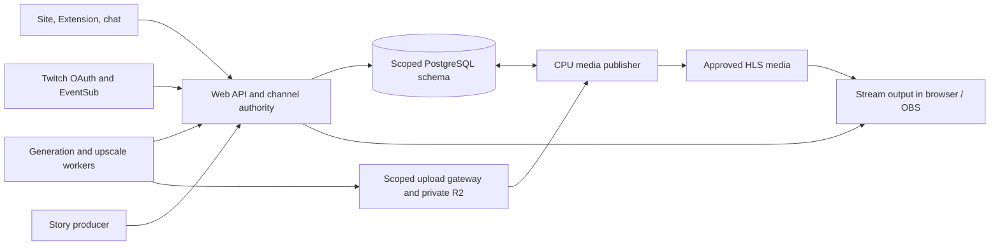

# Architecture and delivery plan

Updated October 31, 2026. This is the entry point for current behavior and remaining work. “Implemented” means the code path exists; “verified” means the cited local or production path was exercised. A local test does not establish live Twitch delivery or sustained production operation. Detailed evidence is in the [completion plan](completion-plan-2026-10-27.md); acceptance cases remain in the [test specification](../.omx/plans/sloptogether-test-spec.md).

## Product and boundaries

A Twitch channel can own multiple independent streams. Viewers propose and vote through the site or Twitch Extension; chat uses the same election. The broadcaster and authorized reviewers control future content. The browser plays the program for ordinary OBS window capture. Normal story clips target about 15 seconds; subscriber alerts use a separate approximately 10-second contract. Published output is 16:9.

The Next.js app under `apps/web` owns identity, stream/election state, moderation, job admission and playback control. `packages/contracts` defines shared contracts and `db/migrations` defines the isolated `sloptogether` schema. The upload gateway issues a narrow path into private storage; the supervised media publisher validates and screens uploaded media, enforces attempt deadlines, and publishes approved HLS. The shared Python worker in `workers/runtime` provides story, generation and upscale roles. Fal/Linux and the experimental Windows/WSL2 client use that protocol; the vendored ComfyStreamer snapshot supplies inference dependencies, not application authority. The Clips.gg host mounts the child app; it is a separate deployment boundary. See [deployment](deployment.md), [worker protocol](worker-upload-protocol.md), and [trust rules](moderation-and-trust.md).

Jobs are scoped to a stream and fenced by leases, attempt deadlines and revisions. Input screening, funding, upload integrity, approval and publication are separate gates. Trusted worker authority comes from server-side grants, not worker claims; ordinary contributor outputs require the configured review. Committed playback history is immutable, and a late upscale cannot rewrite it. Optional upscale must have a bounded pre-air fallback. Subscriber events are deduplicated and queued before acknowledgment; ready alerts interrupt at a safe boundary and resume the story.

## Working now

| Feature | What works | Evidence and limit |
|---|---|---|
| Proposals and voting | Viewers can submit proposals through the site or Extension. Site, Extension and chat ballots use the same stream election. | Local integration records linked Extension and signed chat ballots, then leases the winner to a generation worker. Separate-viewer and live-chat qualification remain. |
| Resub messages | When enabled, `!prompt <idea>` in a resubscription message creates a screened proposal for the normal vote. Other resub text is not treated as a prompt. | The signed EventSub handler and proposal path are implemented. Live Twitch registration and delivery remain unqualified. |
| Workers and publication | Shared worker roles claim generation/upscale work; scoped uploads pass validation, review and HLS publication. | Recorded real Fal renders and upscales reached an eight-span program, some with manual approval. This is finite-path evidence, not continuous unattended operation. |
| Playback | Browser output plays the channel HLS program and supports clip jumps, seeking and pause/resume. | Checked locally and on the deployed page. Subscriber alert insertion and return-to-story switching in the browser remain unqualified. |
| Subscriber alerts | Signed subscription events can enter the durable queue and produce a worker job under the channel's budget and policy. | Local integration covers signed intake, deduplication, worker leasing and publication metadata. Live Twitch delivery, spoken output and browser interruption/resume remain unqualified. |
| Windows | A WSL2 setup bundle and shared worker client exist; native Windows inference is unavailable. | No signed Windows release or RTX 4090 execution/qualification is recorded. |
| Paid features | The fixed-SKU Bits Prompt Lock is implemented behind disabled operator gates. It applies to an eligible, screened proposal and uses the shared worker path; H3 Max Turbo is a separate product and remains disabled. | Twitch review and a released Extension are still required. The guarded local PostgreSQL test does not establish live Bits delivery or production readiness. |

Evidence, test counts and exact historical observations belong in the [completion plan](completion-plan-2026-10-27.md) and [Fal runbook](fal-upscale-runbook.md). Recheck deployment identities and service health before operating; the observed Mac publisher targets the local database, so production publication is not established as durable.

## Remaining work and acceptance gates

1. **Reconcile deployment and operate publication.** Inventory deployed web, gateway, publisher, Fal images and migrations; preserve compatibility and existing data. Deploy and supervise a production publisher with scoped credentials, readiness, recovery and alerts. Verify the host mount, OAuth, uploads, media ranges, old URLs, two-stream isolation and rollback. Migration 021 and stream routes were reported deployed; verify rather than repeat the migration blindly.
2. **Prove continuous generation.** Run the normal producer → lease → inference → upload → screening/review → HLS → browser path for fresh clips and upscale. Prove restart, fencing, tail wait/resume and fallback; run the 20-minute recovery and separate 60-minute fresh-output acceptance gates. Measure throughput, buffer, latency and cost before claiming real-time supply. Keep Fal runs within the externally enforced two-hour limit and verify shutdown. The two style comparisons described in the completion plan remain separate app-path demonstrations.
3. **Qualify subscriber alerts.** Finish any missing template-library and lifecycle work, then test real authorized EventSub delivery, deduplication, bounded funding, spoken name/action, safe interruption and resume. Isolated signed webhook tests do not prove a live event.
4. **Qualify Twitch participation.** Test a separate viewer across Extension, site and chat, including stream isolation, stale ballots, permissions, bans and moderation during active jobs. Complete Twitch Extension review and release.
5. **Deliver Windows contribution.** Build and run the actual executable on Windows; validate clean-machine setup, pinned runtime and model downloads, pairing, both worker roles, recovery and uninstall. Measure generation and upscale on an RTX 4090, including VRAM, host RAM, latency and quality; sign and publish only a qualified release. The current low-VRAM upscale profile requires 128 GiB host RAM and needs a practical qualified profile or an explicit limitation.
6. **Resolve paid interaction and public operations.** Obtain written Twitch clearance for the exact paid interaction before enabling it, settle pricing and unfulfilled-purchase handling, and qualify receipt and provider uncertainty. Complete scoped credentials, backup/restore, retention, monitoring, incident response, licenses and release checks independently of monetization.

The work can overlap after deployment is stable, but all public claims must match the evidence for each component. External dependencies include a durable CPU host, an authorized live broadcaster/subscription event, a Windows RTX 4090 machine and signing service, and Twitch approval of the paid interaction. Product choices still open are tracked in [open questions](open-questions.md).

## Document map

- [Completion plan](completion-plan-2026-10-27.md): detailed work, historical observations and phase-specific acceptance.
- [Acceptance specification](../.omx/plans/sloptogether-test-spec.md): full test and hardware gates; individual assertions still require current evidence.
- [Product decisions](product-decisions.md) and [open questions](open-questions.md): requirements and unresolved choices.
- [Deployment](deployment.md), [Fal runbook](fal-upscale-runbook.md), [subscriber messages and alerts](subscriber-interrupts.md): operational and feature detail.
- Older audits, reviews, import plans and `.omx/plans/sloptogether-plan.md` preserve rationale and historical snapshots. Their status and sequence are superseded by this page and the completion plan; they are not evidence of current deployment.
