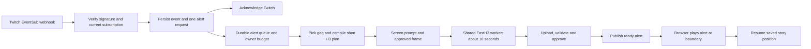

# EventSub subscriber meme video plan

Updated October 27, 2026, America/Los_Angeles. **Planning document; this is not a claim of live qualification.** Part of the [remaining product plan](completion-plan-2026-10-27.md).

## Product behavior

With the feature enabled, a Twitch subscription triggers a personalized, approximately **ten-second** animated meme. Example: “LunaByte just subscribed, and their rocket turned into a confetti cannon!” The video must show the rocket/confetti action and deliver the short spoken acknowledgment. A caption rendered by the app can display the screened exact handle; do not rely on video-model lettering.

The ready clip plays in the channel's chosen SlopTogether stream at a safe boundary and returns to the story. The browser remains the OBS capture source. Normal story clips remain about fifteen seconds. Subscription payment is not an app payment or render budget.

## Existing implementation to extend

| Area | Existing source | Remaining work |
|---|---|---|
| Webhook and registration | `apps/web/src/lib/server/subscriber-service.ts`; `apps/web/src/app/api/v1/[...path]/route.ts` | Qualify live registrations/revocations; persist/reconcile lifecycle and stream routing |
| Signature and receipts | `verifyEventSubMessage`, `handleEventSubWebhook`, `admitSubscriptionEvent` in subscriber service | Keep raw-body verification/deduplication; prove retry/crash behavior and registered-subscription matching |
| Queue and funding | `subscription_events`, `interrupt_requests`, `funding_authorizations`, durable outbox | Ten-second policy, selected stream, template snapshot, budget/expiry and burst behavior |
| Story planning | `apps/web/src/lib/server/worker-service.ts`; `workers/runtime/src/sloptogether_worker/story_producer.py` | Versioned gag library, rotation, action/dialogue consistency and deterministic retry |
| Duration contract | `packages/contracts/src/index.ts` requires 10 seconds for subscriber clips; admission queues 243 frames at 24 fps and the generation lease uses the dedicated 10-second FastH3 recipe | Local code and guarded PostgreSQL tests cover the duration contract; qualify a real Twitch event and playback/resume before marking complete |
| Rendering/publication | Common worker runtime; `workers/media-publisher/src/index.mjs` and `publish.mjs` | Actual ten-second FastH3 recipe, ready-alert scheduling and trust qualification |
| Playback/review | `program-player.tsx`, `program-service.ts`, separate control/moderation UI | Once-only insert/resume with buffered media, rewind, controller transfer and multiple streams |

Reuse these interfaces and tables. Add only missing fields/constraints in additive migrations within the existing `sloptogether` schema; do not introduce another queue, unauthenticated render endpoint or separate GPU engine.

## 1. Finish EventSub authorization and lifecycle

- Use the existing HTTPS webhook at `https://www.clips.gg/sloptogether/api/v1/webhooks/eventsub`; no permanent websocket listener is required in the Vercel request runtime.
- Obtain the broadcaster's `channel:read:subscriptions` grant for this OAuth client. Register webhook subscriptions using the matching app access token, persist Twitch subscription IDs and status, and handle the verification challenge before claiming the channel is connected.
- Keep OAuth grant refresh/revocation separate from whether a browser tab remains open. Inspect the current session-backed authorization checks; grant expiry must be visible and cannot be worked around by a stale channel setting.
- Reconcile enabled, pending, failed and revoked subscriptions from a supervised CPU task. Avoid duplicate registrations; rotate webhook secrets with the existing current/previous-secret overlap and recover changed callback configuration.
- Configure alerts on/off, enabled event types, one target stream, template/style set, audio, budget, cooldown and expiry in streamer/mod controls. Only the broadcaster can grant new Twitch permissions; preserve moderator configuration rights that already exist.

| Event | Alert behavior |
|---|---|
| `channel.subscribe` | One new-sub alert; inspect `is_gift` to apply gift policy. Twitch excludes resubs from this event. |
| `channel.subscription.message` | Optional alert when a viewer shares a resubscription message. This does not observe every automatic renewal. Ignore the raw message as planner instructions. |
| `channel.subscription.gift` | Optional single gifter/batch alert, with total count and anonymous identity respected. |

Gift mode is either off, one gifter/batch alert, or recipient alerts. Do not render the aggregate gift and its recipient events as duplicate shout-outs. Deduplicate identical Twitch message IDs. Apply the explicit gift-mode rule across aggregate/recipient event types; do not collapse unrelated subscriptions merely because their names or timestamps are close.

Sources: [event types](https://dev.twitch.tv/docs/eventsub/eventsub-subscription-types/), [webhook authorization and registration](https://dev.twitch.tv/docs/eventsub/manage-subscriptions/).

## 2. Make receipt handling safe and durable

- Verify the HMAC over message ID, timestamp and exact raw request body, compare in constant time, validate timestamp/body bounds, and match the subscription/channel/client/version to a current registered configuration. Verify challenges and revocations as well as notifications.
- Persist a minimal receipt and one derived request transactionally before returning a success response. No planner, moderation provider or GPU call belongs in the webhook handler. A failed database write must remain retryable by Twitch.
- Use durable uniqueness for event/request, budget reservation and work identities. Retries after a process crash cannot generate another plan, charge another attempt or play another alert. Treat Twitch delivery as potentially duplicated/out of order.
- Store sanitized identity and required event fields. Names are bounded data, never prompt instructions or HTML; omit raw resub text by default and retain only necessary data with a documented expiry.
- Snapshot the channel policy revision, target stream, selected template/version, approved image digest and expiry. The target stream must belong to the subscribing channel. Default to `main`; changing settings must not reroute an existing event or fan it out silently.

Source: [Twitch webhook verification, challenges and notifications](https://dev.twitch.tv/docs/eventsub/handling-webhook-events/).

## 3. Build a reusable animated gag library

Start with 20–30 reviewed ideas. Each template has a stable ID/version, style tags, approved reusable start/end frames when needed, fictional character description, visual beats, camera, short dialogue, sound cues and exclusions. Rotate by event ID and recent channel history; persist the choice so retries do not change the gag.

Starter ideas:

| Template | Visible ten-second gag |
|---|---|
| Rocket confetti | A cartoon rocket blasts off, puffs into confetti, and the astronaut drifts down waving |
| Mecha upgrade | A tiny robot receives an absurdly huge crown, wobbles, then strikes a heroic pose |
| Dragon delivery | A friendly miniature dragon drops a gift crate and sneezes a burst of streamers |
| Anime power-up | A character builds an enormous energy aura, which becomes a cloud of rubber ducks |
| Banana landing | A space banana lands triumphantly on the moon and slips onto a springy cushion |
| Duck portal | A wizard opens a portal and a parade of toy ducks marches through |
| Game-show cannon | A cheerful announcer launches a contestant onto an inflatable victory throne |
| Giant toast | A toaster launches a cartoon hero on a slice of toast; they surf to a victory banner |
| Cat command center | A cat captain presses a large button and the spaceship becomes a disco ball |
| Knight parade | A tiny knight enters riding an oversized snail with a confetti flag |
| Cloud elevator | A character rides a cloud upward and emerges wearing a ridiculous superhero cape |
| Gift avalanche | Wrapped boxes tumble into a cheerful pile and reveal a waving fictional mascot |

For a ten-second clip use one setting and one main action: setup in the first two seconds, the gag during seconds two–eight, then a short payoff. Aim for one clear 12–20-word spoken line; check name length and the existing compiler limit. Do not fill a short clip with unrelated motion or ask the model to spell a banner accurately.

Use template substitution by default, requiring no paid text call. An optional configured cheap text model may vary the same bounded structured fields once; schema failure or provider outage returns the approved template. Store the final compiled prompt and version, and enforce the same action in the visual beats and dialogue. Do not let the planner select funding, stream routing, credentials or playback authority.

**No automatic Comfy image generation.** Streamer/moderators can manually create a low-cost approved style image in advance. Alerts reuse that image pool or an explicitly approved current frame. A missing approved frame skips/holds the alert with a clear reason; it never spends the Comfy key automatically.

## 4. Render an actual ten-second clip

- Keep subscriber admission fixed at `durationSeconds:10` without changing normal story defaults; the worker recipe uses 243 frames (10.125 seconds at 24 fps) to satisfy FastH3 Trim's frame contract.
- Carry that target through the planning payload, H3 compiler, immutable job recipe, worker lease, native supported frame count, media validation and program timing. Create a separate versioned alert recipe if the pinned fifteen-second graph cannot accept the duration safely.
- Use 512×288 16:9 base video and the imported five-step FastH3 Trim route. Qualify approximately 10 seconds, normally within 9.5–10.5 seconds, against actual decoded duration/frame timestamps. Do not silently render fifteen seconds while claiming ten, or trim away the spoken payoff.
- Run the compiled prompt, name/line and actual reference frames through input screening. Use trusted managed workers for timely alerts; public donor output still requires its configured review.
- Verify audible intelligible dialogue and the actual requested visual gag. Presence of an AAC track alone does not establish speech. Preserve audio in optional SoL upscale.
- Keep upscale optional and out of the default alert latency path. If enabled, it has its own accepted-source dependency, reservation and ready deadline. Never delay a usable alert indefinitely waiting for enhancement.

## 5. Bound priority, cost and latency

- Alerts are a separate job kind using the existing claim/fence protocol. Give bounded priority to the next eligible claim; do not cancel a running paid/story render to manufacture immediacy. Reserve story capacity or cap consecutive alerts to avoid starving continuous playback.
- Reuse existing owner-budget reservations, hourly cap, minimum gap, maximum pending count and event freshness checks. Add a daily cap if needed. A Twitch subscription does not provide app-owner funds automatically.
- Default gift bursts to one batch acknowledgment when enabled. Overflow, stale events, missing workers, disabled output or exhausted budget should expire/skip with an audit reason instead of accumulating an hour of delayed alerts.
- One admitted event authorizes one planned attempt under the configured budget. Provider-status and upload recovery may resume that same attempt; a fresh inference attempt needs fresh explicit owner authorization/reservation under the channel policy.
- Keep automatic GPU wake disabled unless an explicitly bounded owner session is active. If no session can serve the event, queue within its short expiry or skip. Every Fal session must still stop within two hours.
- Record receipt → persisted → planning → render start/end → uploaded → validated → ready → played timestamps, template ID, input/output digests, approval mode, spend and skip reason. Report measured cold/warm latency and percentile distributions; “ten seconds” describes clip duration, not guaranteed generation latency.

Initial controls can retain current conservative values: feature off, minimum gap 60 seconds, event max age 180 seconds, queue cap 20 and owner spend cap zero until configured. Select an enabled template set and one target stream explicitly. Review these values after measuring generation latency and story-buffer impact.

## 6. Insert and resume through the browser controller

- Publish the accepted alert as a separate program item. The elected controller schedules it at the next safe boundary only after the media is ready, approved and not expired.
- Record a single durable insert command with target stream, controller epoch and saved next story position. Use existing jump/resume authority; do not rewrite already committed HLS history or a buffered paid story slot.
- After the alert finishes, resume at the saved story item/PTS once. Handle controller takeover, refresh and disconnect with the same command identity so the clip is not repeated or the story skipped.
- Rewinding old history must not retrigger old subscription events. Two streams on one channel must not steal each other's playheads or alert state. If seek/takeover happens during an alert, reconcile explicitly against the current controller command.
- Provide short controls in the moderator/streamer view: enable, template set, target stream, preview/test, pending, cancel/skip and budget. Keep the ordinary output page focused on video.
- A synthetic preview/test action is clearly marked and uses normal funding, screening, render and publication paths; it must not create a fake verified Twitch subscription receipt.

## 7. Qualification and rollout

1. Unit and isolated Postgres cases: signature/timestamp/size, challenge, known subscription, replay, concurrent delivery, grant revocation, policy changes, gifts, anonymous gifts, stream isolation, budget race and worker fencing.
2. Twitch CLI webhook challenge/notification tests: valid receipt creates one durable request; duplicate/retry does not create another; invalid signatures and stale/mismatched channel events fail. A Twitch CLI simulation is not evidence of a real subscriber event.
3. Local full-flow test: approved asset pool → selected template → about-ten-second native Trim output with named speech/action → validation/review → browser interruption/resume. Include worker restart, missing audio, failed render, expired request, disabled setting, queue overflow and already-buffered story.
4. Production canary on one channel/target stream with conservative caps: verify actual Twitch subscriptions are enabled, then observe a real event when one is available. Do not purchase subscriptions as part of testing without separate authorization. Capture event/request/job/program IDs and actual browser/video/audio evidence.
5. Confirm disabled mode and expiry create no new provider spending; no duplicate playback or billable render on redelivery; unrelated story/paid slots and streams remain intact. Verify the two-hour Fal cutoff and zero GPUs after test completion.

**Release gate:** one actual subscribed viewer is acknowledged by the correct ~10-second animated gag, with audible matching speech, normal media admission, once-only browser playback and correct story resume; security/burst/recovery cases pass separately. The local duration and publication path are implemented and integration-tested, but no real Twitch event, generated clip, or live browser interruption has satisfied this gate yet.

## Remaining access and decisions

- Real channel subscription authorization and Twitch capability/eligibility must be available for live canary delivery. Do not infer this from ordinary Twitch login.
- The owner configures a small alert budget and one target stream. Defaults can be established locally; they are not reasons to stop planning or implementation.
- Start with generic fictional cartoon avatars, the reviewed gag library, template text and base-quality alerts. More elaborate personalization, automatic image calls and mandatory upscale are not prerequisites.
